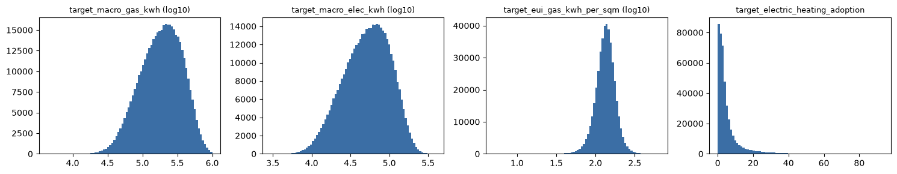
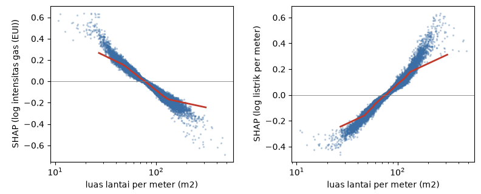
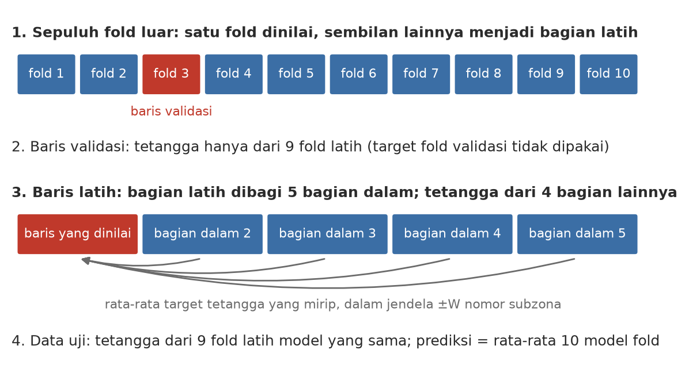
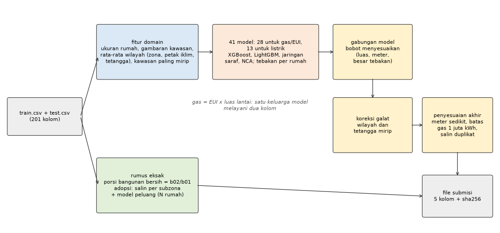
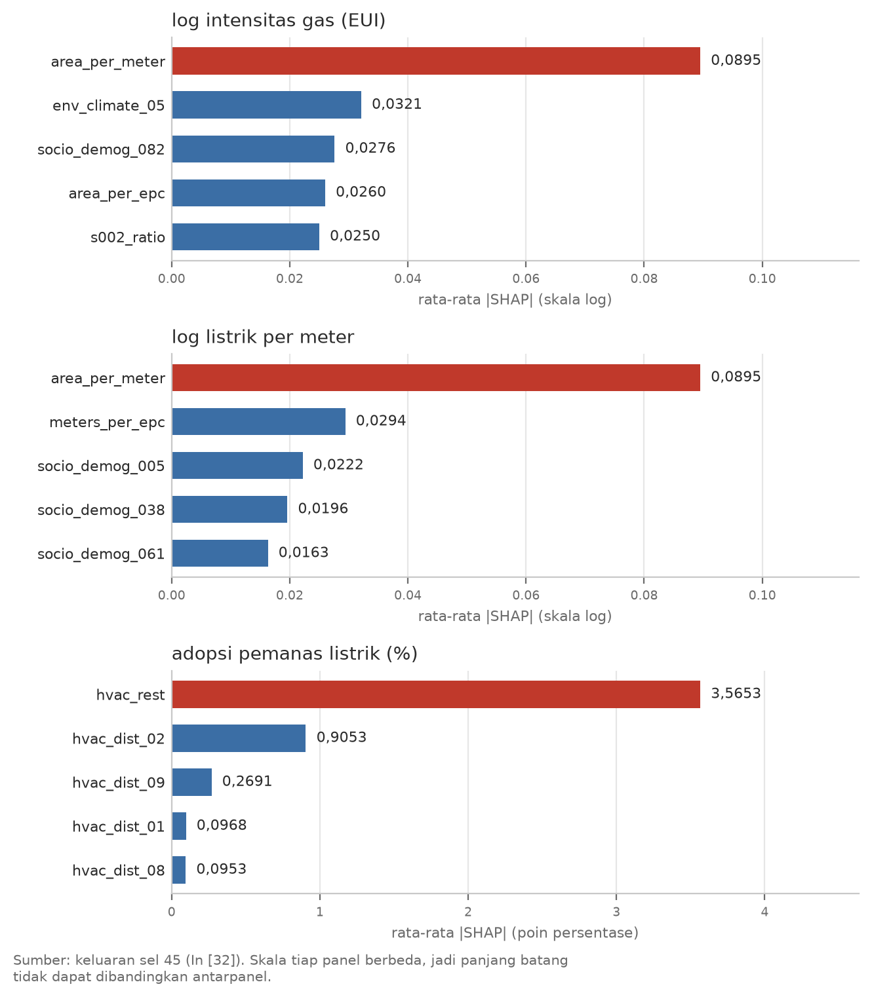
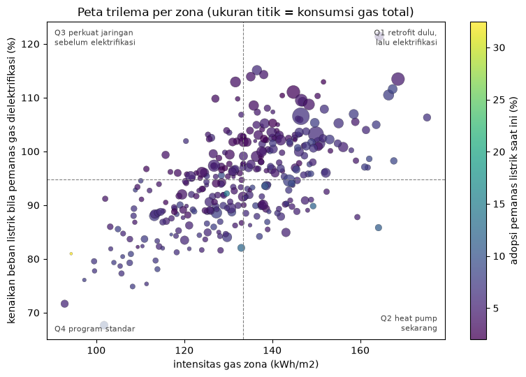
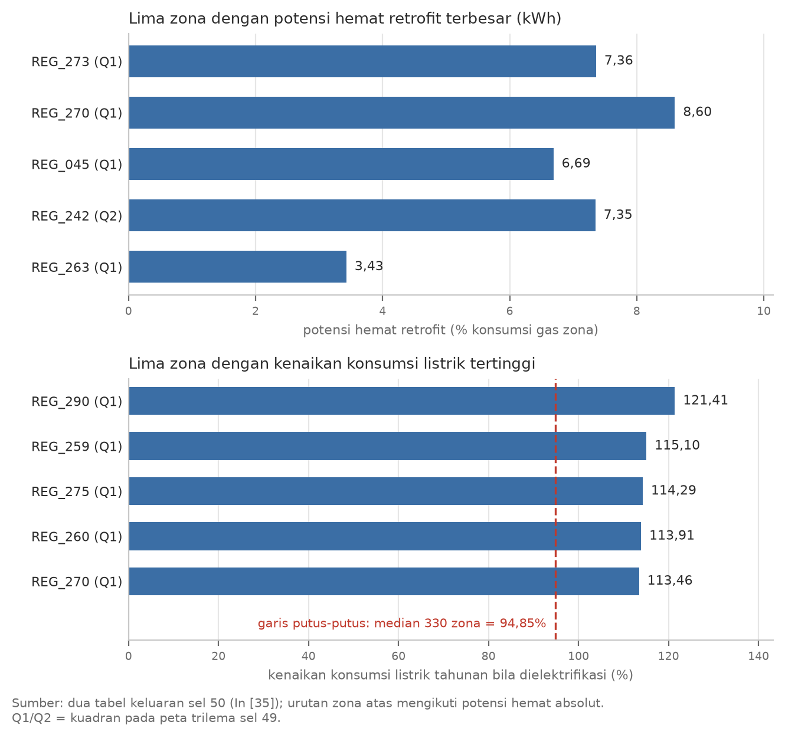
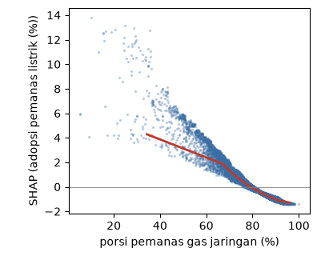
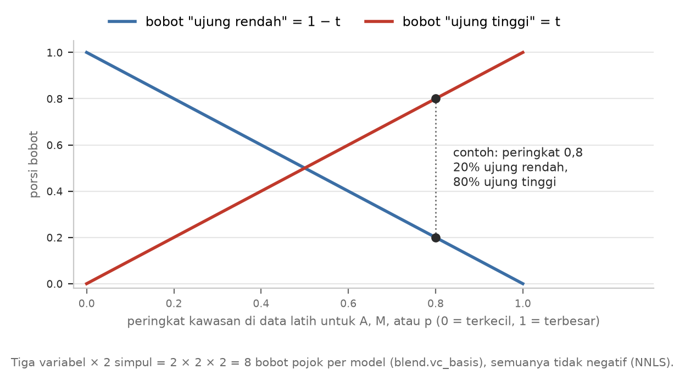

# Struktur Pitch Deck Final (10 menit): Tim BISMILLAH, DICE FEST 2026

## Sumber dan aturan penyusunan

**Sumber yang dipakai:**
- notebook `final/deliverables/DICEFEST2026_BISMILLAH.ipynb`;
- naskah `01_naskah_fitur_arsitektur.md` dan `02_naskah_kebijakan.md`.

**Aturan nomor sel dan angka:**
- Nomor sel dihitung dari 0. Nomor eksekusi Jupyter `In [n]` ditulis di sebelahnya supaya mudah dicari.
- Semua angka berasal dari teks markdown atau keluaran sel notebook (`fakta_notebook.txt`). Angka yang dibulatkan,
  dibaca dari grafik, atau diambil dari kode dan konfigurasi dicatat bersama sumbernya di `fakta_turunan.md`.
- Pemeriksa otomatis `check_deck.py` dari skill `pitch-deck-kompetisi` dijalankan dengan kedua berkas itu sebagai
  lembar fakta. Hasilnya: 0 galat, 0 peringatan, dan total 8 menit 45 detik untuk 9 slide.

**Konteks penyusunan:**
- **Juri campuran,** yaitu data scientist dan pembuat kebijakan. Karena itu setiap istilah teknis punya penjelasan satu
  kalimat di kolom "Istilah". Kolom ini ditampilkan sebagai catatan kecil di bawah slide.
- **Data bersifat umum dan tidak spesifik negara.** Nama kolom disamarkan, jadi makna kolom disebut sebagai dugaan.
- **Pembagian waktu mengikuti bobot nilai:**
  - solusi kebijakan (35%) mendapat 3 menit 55 detik;
  - rekayasa fitur (25%) 2 menit 30 detik;
  - arsitektur model (15%) 1 menit 20 detik;
  - pembuka (masalah dan hasil utama) tepat 60 detik pertama.
  - Total paparan 8 menit 45 detik, menyisakan 45 detik dari batas 9,5 menit.

## Slide 1. Masalah dan hasil utama (60 detik)

- **Bagian rubrik:** Pembuka
- **Judul:** Lima angka energi untuk 613 ribu kawasan, diterjemahkan menjadi peta prioritas 330 zona
- **Visual utama:** sel 27 (In [23]), grafik "Sebaran target": histogram gas, listrik, dan EUI (log10) serta adopsi.

  

- **Isi:**
  - Trilema: emisi, keandalan jaringan listrik, keterjangkauan biaya.
  - Skor *leaderboard* publik 0,24913 dari 41 model.
  - Potensi hemat *retrofit* 7,39 TWh; konsumsi listrik zona naik median 94,85% bila dielektrifikasi.
- **Istilah:** *Leaderboard*: papan skor lomba; makin kecil skornya, makin akurat prediksinya. *Retrofit*: perbaikan dinding, atap, dan jendela supaya rumah tidak boros panas. TWh (terawatt-jam): satuan energi sebesar satu miliar kWh. Elektrifikasi: mengganti pemanas gas dengan pemanas listrik.
- **Narasi pembicara (±60 detik):** Kota yang beralih dari pemanas gas ke pemanas listrik menghadapi tiga tuntutan sekaligus: emisi harus turun, jaringan listrik harus tetap andal, dan biaya harus terjangkau. Lomba ini meminta lima angka energi untuk setiap kawasan permukiman: gas, listrik, intensitas gas per meter persegi, porsi bangunan bersih, dan adopsi pemanas listrik. Kami memprediksi kelimanya untuk 613 ribu kawasan dengan gabungan 41 model, dengan skor leaderboard publik 0,24913. Model yang sama lalu kami ubah menjadi peta prioritas 330 zona. Hasil utamanya: perbaikan bangunan berpotensi menghemat 7,39 terawatt-jam gas, dan bila pemanas gas diganti pompa panas, konsumsi listrik tahunan zona naik dengan median 94,85 persen. Kami mulai dari datanya.

## Slide 2. Struktur data (40 detik)

- **Bagian rubrik:** Rekayasa fitur dan pra-pemrosesan
- **Judul:** Dua target terjawab oleh struktur data sebelum model dilatih
- **Visual utama:** tabel keluaran sel 25 (In [22]), `report.identity_checks`:

  | identitas / struktur | hasil cek |
  |---|---|
  | EUI x luas lantai (bld_dim_06) = gas | galat relatif maks 6.7e-16 |
  | rasio bangunan bersih = round(100 x bld_dim_02 / bld_dim_01, 2) | tepat di 100.00% baris train |
  | adopsi pemanas listrik konstan per subzona | 100.00% subzona |
  | porsi test dari semua baris | 0.300000 (split acak 70/30 per baris) |
  | baris test di subzona yang ada di train | 91.86% |

- **Isi:**
  - Gas = EUI × luas lantai: satu keluarga model untuk dua kolom.
  - Porsi bangunan bersih dihitung dengan rumus, bukan ditebak.
  - Adopsi seragam per subzona: 91,86% kawasan uji tinggal disalin.
- **Istilah:** EUI: konsumsi gas per meter persegi lantai, ukuran efisiensi bangunan. Subzona: wilayah kecil yang berperilaku seperti satu unit sensus. Identitas: rumus yang selalu tepat di seluruh data, bukan perkiraan.
- **Narasi pembicara (±40 detik):** Sebelum melatih model, kami membedah datanya. Tabel ini adalah keluaran pemeriksaan di notebook. Gas total selalu sama dengan EUI dikali luas lantai, jadi satu keluarga model cukup untuk dua kolom. Porsi bangunan bersih tepat sama dengan satu rumus, jadi dihitung, bukan ditebak. Adopsi pemanas listrik seragam dalam satu subzona, dan 91,86 persen kawasan uji berada di subzona yang sudah dikenal. Data uji juga diambil acak per baris, sehingga validasi acak meniru kondisi data uji.

## Slide 3. Fitur ukuran rumah (50 detik)

- **Bagian rubrik:** Rekayasa fitur dan pra-pemrosesan
- **Judul:** Ukuran rumah, bukan ukuran kawasan, menjadi fitur terkuat tanpa kebocoran
- **Visual utama:** potongan sel 47 (In [33]), grafik dependensi SHAP: panel kiri atas (log EUI) dan tengah atas (log listrik per meter) terhadap luas lantai per meter.

  

- **Isi:**
  - `area_per_meter` = `bld_dim_06` / `bld_dim_12`: luas rata-rata rumah.
  - Peringkat 1 SHAP untuk log EUI dan log listrik per meter (0,0895).
  - Hanya kolom input, baris demi baris, di data latih dan uji.
- **Istilah:** Fitur: variabel masukan yang dipakai model. Kebocoran data: model tanpa sengaja memakai informasi jawaban yang tidak tersedia saat memprediksi data baru. SHAP: cara membagi setiap tebakan model menjadi sumbangan masing-masing variabel. Skala log: skala yang membuat perubahan persentase yang sama terlihat sama besar.
- **Narasi pembicara (±50 detik):** Gas total suatu kawasan terutama ditentukan oleh jumlah rumah di dalamnya. Yang lebih informatif adalah ukuran rumahnya, jadi kami membuat area per meter: total luas lantai dibagi jumlah meteran, kira-kira luas rata-rata satu rumah. Pada model penjelas, fitur ini peringkat pertama untuk gas maupun listrik, dengan arah berlawanan. Grafik kiri: rumah kecil memakai gas per meter persegi lebih banyak. Grafik kanan: rumah besar memakai listrik per rumah lebih banyak. Fitur ini tidak membocorkan jawaban, karena rumusnya hanya membagi dua kolom input yang tersedia di data uji, tanpa target dan tanpa statistik lintas baris.

## Slide 4. Fitur kawasan termirip (60 detik)

- **Bagian rubrik:** Rekayasa fitur dan pra-pemrosesan
- **Judul:** Kawasan termirip dihitung tanpa melihat target baris yang dinilai
- **Visual utama:** BUAT BARU (K1): skema *cross-fit* dua lapis, mengikuti `train_lib.run` dan `Data._knn_features`; kode di lampiran, fungsi `k1_crossfit`.

  

- **Isi:**
  - Tetangga mirip dicari dalam jendela ±30 sampai ±300 nomor subzona.
  - 99,07% baris berurutan nomor subzona berada di zona sama.
  - *Cross-fit* dua lapis: tidak ada baris memakai targetnya sendiri.
  - LB publik turun dari 0,24954 ke 0,24943.
- **Istilah:** kNN (k tetangga terdekat): mencari k data paling mirip lalu memakai rata-ratanya. *Out-of-fold*: nilai sebuah baris dihitung hanya dari bagian data yang tidak memuat baris itu. Fold: salah satu potongan data ketika data dibagi untuk validasi. *Cross-fit*: menghitung fitur secara bergiliran per potongan data.
- **Narasi pembicara (±60 detik):** Fitur kedua bertanya: berapa konsumsi kawasan lain yang stok bangunannya paling mirip? Kemiripan diukur dari ukuran rumah, cakupan sertifikat energi, jumlah meter, dan komposisi periode bangunan. Pencarian dibatasi pada jendela nomor subzona, karena nomor subzona berurutan secara geografis: 99,07 persen baris yang berurutan nomornya berada di zona yang sama. Karena fitur ini memakai target tetangga, ia dihitung out-of-fold secara berlapis, seperti pada skema ini. Baris validasi hanya mengambil tetangga dari sembilan fold lainnya. Baris latih mengambil tetangga dari empat bagian dalam yang lain. Jadi tidak ada baris yang melihat targetnya sendiri. Ketika fitur ini masuk ke model, skor publik turun dari 0,24954 menjadi 0,24943.

## Slide 5. Arsitektur tiga jalur (80 detik)

- **Bagian rubrik:** Arsitektur model
- **Judul:** Tiga jalur, karena setiap target dinilai terpisah
- **Visual utama:** sel 31 (In [25]), diagram arsitektur `report.architecture_diagram`. Tabel anggota di bawahnya disiapkan untuk tanya jawab.

  

- **Isi:**
  - Gas dan EUI: satu keluarga, 28 model.
  - Listrik: 13 model, pendorongnya berbeda.
  - Porsi bangunan bersih: rumus. Adopsi: disalin, plus 2 LightGBM untuk 8,14% subzona baru.
  - 41 model digabung dengan bobot adaptif; hasil identik saat diulang.
- **Istilah:** XGBoost dan LightGBM: model berbasis banyak pohon keputusan yang dibangun bertahap untuk memperbaiki kesalahan sebelumnya. Jaringan saraf (MLP): model berlapis yang belajar pola dari banyak contoh. NCA: jaringan yang belajar mengukur kemiripan kawasan lalu menebak dari kawasan yang mirip. Bobot adaptif: bobot campuran yang berubah menurut luas, jumlah meter, dan besar tebakan.
- **Narasi pembicara (±80 detik):** Lima target tidak kami paksakan ke satu model. Metrik lomba menilai setiap kolom terpisah, jadi setiap target boleh memakai cara terbaiknya. Jalur pertama untuk gas dan EUI, berisi 28 model, karena keduanya satu besaran: gas sama dengan EUI dikali luas lantai. Untuk kolom gas, kesalahan di kawasan besar dihitung lebih berat. Jalur kedua untuk listrik, berisi 13 model, karena pendorongnya berbeda: porsi sosiodemografi pada listrik lebih besar. Jalur ketiga hampir tanpa model. Porsi bangunan bersih dihitung dengan rumus, dan adopsi disalin dari subzona yang sudah dikenal. Untuk 8,14 persen kawasan di subzona baru, dua model LightGBM menebak berapa rumah tangga di luar kategori tercatat yang bukan pengguna pemanas listrik, lalu hasilnya dirata-rata. Model di dua jalur pertama, yaitu XGBoost, LightGBM, jaringan saraf, dan NCA, digabung dengan bobot tidak negatif yang berubah menurut luas, jumlah meter, dan besar tebakan. Setelah itu galat dikoreksi dengan galat tetangga dan disesuaikan dengan batas data. Hasilnya identik setiap kali dijalankan ulang.

## Slide 6. Pendorong konsumsi menurut SHAP (55 detik)

- **Bagian rubrik:** Solusi kebijakan
- **Judul:** Ukuran rumah mendorong gas dan listrik ke arah berlawanan
- **Visual utama:** BUAT BARU (K2): batang rata-rata |SHAP| lima fitur teratas per target, angka dari sel 45 (In [32]); kode di lampiran, fungsi `k2_shap_bars`. Pendukung: sel 43 (In [31]), porsi kontribusi per kelompok fitur.

  

- **Isi:**
  - Rumah kecil: gas per m² sekitar 65% lebih tinggi.
  - Rumah besar: listrik per rumah sekitar 75% lebih tinggi.
  - Adopsi: `hvac_rest`, `hvac_dist_02`, `hvac_dist_09`, yaitu komposisi pemanas, bukan sebab.
- **Istilah:** Model penjelas: satu LightGBM per target yang hanya memakai karakteristik kawasan terukur, khusus untuk dibaca. Identitas akuntansi: hubungan pasti karena semua porsi jenis pemanas berjumlah 100%, bukan karena sebab-akibat. `hvac_rest`: sisa porsi pemanas (listrik dan lainnya); `hvac_dist_02`: gas jaringan; `hvac_dist_09`: dua jenis pemanas atau lebih (makna dugaan, nama kolom disamarkan).
- **Narasi pembicara (±55 detik):** Untuk kebijakan, kami melatih satu model penjelas per target yang hanya memakai karakteristik kawasan terukur, lalu membacanya dengan SHAP. Ukuran rumah adalah pendorong terbesar untuk gas dan listrik, tetapi arahnya berlawanan. Rumah kecil memakai gas per meter persegi sekitar 65 persen lebih banyak, karena dinding dan atapnya relatif luas dibanding ruang yang dipanaskan. Rumah besar memakai listrik per rumah sekitar 75 persen lebih banyak. Untuk adopsi pemanas listrik, tiga variabel teratas adalah komposisi pemanas. Ini sebagian besar identitas akuntansi, jadi kami membacanya sebagai gambaran kondisi kawasan, bukan sebagai tombol yang bisa diputar.

## Slide 7. Peta trilema 330 zona (65 detik)

- **Bagian rubrik:** Solusi kebijakan
- **Judul:** Peta 330 zona menentukan urutan program di setiap wilayah
- **Visual utama:** sel 49 (In [34]), grafik "Peta trilema per zona" beserta tabel kuadran keluarannya (kolom kebijakan tidak ditampilkan karena label Q2 di keluaran adalah label lama).

  

  | kuadran | zona | gas_TWh | hemat_retrofit_TWh | kenaikan_beban_rata2_pct | porsi_gas |
  |---|---|---|---|---|---|
  | Q1 | 118 | 66.095 | 3.650 | 102.494 | 0.468 |
  | Q2 | 47 | 16.299 | 1.073 | 90.245 | 0.115 |
  | Q3 | 47 | 20.607 | 0.858 | 99.102 | 0.146 |
  | Q4 | 118 | 38.354 | 1.810 | 87.042 | 0.271 |

- **Isi:**
  - Sumbu datar: intensitas gas. Sumbu tegak: kenaikan konsumsi listrik tahunan bila dielektrifikasi.
  - Q1: 118 zona, 46,8% gas, 3,65 TWh potensi *retrofit*.
  - Total potensi 7,39 TWh, atau 5,23% dari 141,35 TWh.
- **Istilah:** Kuadran: empat kelompok zona yang dibentuk garis nilai tengah (median) di kedua sumbu. Pompa panas (*heat pump*): pemanas listrik yang menghasilkan sekitar 3 kWh panas dari 1 kWh listrik. "Kenaikan beban" pada grafik dan tabel: kenaikan konsumsi listrik tahunan, bukan beban puncak.
- **Narasi pembicara (±65 detik):** Supaya bisa dipakai, temuan itu kami ringkas per zona. Nilai aktual kawasan latih dan prediksi kawasan uji digabung menjadi 330 zona. Setiap titik di peta adalah satu zona. Sumbu mendatar adalah intensitas gasnya. Sumbu tegak adalah kenaikan konsumsi listrik tahunan bila pemanas gas diganti pompa panas, dengan asumsi 80 persen gas dipakai untuk pemanasan dan efisiensi pompa panas 3. Garis median membagi zona menjadi empat kuadran. Kuadran pertama, intensitas tinggi dan kenaikan listrik tinggi, berisi 118 zona dengan hampir separuh konsumsi gas, dan 3,65 dari 7,39 terawatt-jam potensi penghematan. Kata beban di grafik berarti konsumsi tahunan, bukan beban puncak. Setiap kuadran butuh urutan program yang berbeda, dan itulah dasar tiga rekomendasi kami.

## Slide 8. Rekomendasi 1 dan 2 (65 detik)

- **Bagian rubrik:** Solusi kebijakan
- **Judul:** *Retrofit* dulu di Q1, jaringan disiapkan sebelum subsidi pompa panas
- **Visual utama:** BUAT BARU (K3): dua diagram batang zona teratas, angka dari dua tabel sel 50 (In [35]); kode di lampiran, fungsi `k3_zone_bars`.

  

- **Isi:**
  - R1: *retrofit* kawasan rumah kecil dan bangunan lama, mulai REG_273, REG_270, REG_045.
  - R2: cek kapasitas gardu dulu, mulai REG_290 (+121,41%).
  - Subsidi pompa panas bertahap, dengan tarif waktu pemakaian.
- **Istilah:** Selubung bangunan: dinding, atap, dan jendela yang memisahkan ruang dalam dari udara luar. Gardu: titik distribusi listrik yang melayani satu lingkungan. Tarif waktu pemakaian: harga listrik lebih murah di jam sepi supaya pemakaian tidak menumpuk di jam sibuk.
- **Narasi pembicara (±65 detik):** Rekomendasi pertama: dahulukan perbaikan selubung bangunan, yaitu dinding, atap, dan jendela, di kawasan dengan rumah kecil dan bangunan periode lama. Potensi ini dihitung per zona dari sumbangan SHAP stok bangunan, dan hampir separuhnya ada di kuadran pertama. Kandidat awalnya REG_273, REG_270, dan REG_045. Di kuadran ini, perbaikan bangunan dijalankan sebelum pompa panas, supaya kebutuhan panas turun dulu. Rekomendasi kedua: siapkan jaringan sebelum subsidi pompa panas. Di REG_290, konsumsi listrik tahunan bisa naik 121 persen bila pemanasnya dielektrifikasi penuh. Operator jaringan perlu menilai kapasitas gardu lebih dulu, terutama di kawasan rumah besar, yang menurut SHAP konsumsi listrik per sambungannya sudah paling tinggi. Setelah itu subsidi dibuka bertahap, disertai tarif berbasis waktu pemakaian.

## Slide 9. Rekomendasi 3 dan penutup (50 detik)

- **Bagian rubrik:** Solusi kebijakan
- **Judul:** Kawasan yang sudah tersambung gas butuh program elektrifikasi khusus
- **Visual utama:** potongan sel 47 (In [33]), panel kanan atas: SHAP adopsi terhadap porsi pemanas gas jaringan.

  

- **Isi:**
  - Sumbangan porsi gas jaringan sekitar +4,3 poin pada ±35%, negatif di atas ±80%.
  - Pola deskriptif (identitas akuntansi), bukan tombol kebijakan.
  - Pilot bertahap: bantuan pompa panas di zona seperti REG_045 (adopsi 2,60%).
- **Istilah:** Pilot bertahap: program dibuka bergiliran per zona, supaya dampaknya bisa dibandingkan dengan zona yang belum ikut. Poin persentase: selisih langsung antara dua persentase, misalnya dari 2% ke 6% berarti naik 4 poin.
- **Narasi pembicara (±50 detik):** Rekomendasi ketiga menyangkut adopsi. Sumbangan porsi gas jaringan sekitar plus 4 poin pada porsi 35 persen dan negatif di atas 80 persen, sedangkan sosiodemografi hanya sekitar 15 persen. Karena ini identitas akuntansi, kami tidak mengklaim bahwa mengubah variabel itu menaikkan adopsi. Yang kami baca: adopsi saat ini hampir hanya ada di kawasan yang belum tersambung gas. Maka kawasan berjaringan gas perlu program khusus, misalnya bantuan pemasangan pompa panas dan pembongkaran ketel lama, sebagai pilot bertahap. SHAP menunjukkan sumbangan pada prediksi, bukan sebab-akibat. Ringkasnya: perbaiki bangunan dulu, siapkan jaringan, lalu dorong kawasan bergas secara khusus.

## Cadangan C1. Bobot adaptif A2xM2xp2 (tanya jawab)

- **Bagian rubrik:** Arsitektur model, cadangan tanya jawab
- **Judul:** Bobot setiap model berubah halus menurut luas, jumlah meter, dan besar tebakan
- **Visual utama:** BUAT BARU (K4): basis segitiga dua simpul dari `blend.size_basis`; kode di lampiran, fungsi `k4_hat_basis`.

  

- **Isi:**
  - Peringkat A, M, dan p di data latih membentuk 2 × 2 × 2 = 8 bobot pojok per model.
  - NNLS: semua bobot ≥ 0; 224 bobot untuk gas/EUI, 104 untuk listrik.
  - Skor jujur gabungan global: gas 0,24494; EUI 0,65023; listrik 0,31587 (sel 35).
  - LB publik 0,24934 → 0,24925 setelah bobot adaptif (sel 37).
- **Istilah:** Peringkat: posisi relatif kawasan, dari terkecil (0) sampai terbesar (1). Simpul (*knot*): titik tempat bobot ditetapkan; di antara simpul, bobot berubah mengikuti garis lurus. NNLS: kuadrat terkecil dengan bobot tidak negatif.
- **Pedoman jawaban:** Lihat `03_qna_juri.md` P1 dan P2. Intinya: model yang paling akurat di kawasan kecil belum tentu paling akurat di kawasan besar. Bentuk ini dipilih dengan validasi bersarang saat pengembangan (catatan D012), dan tiga simpul tidak lebih baik daripada dua. Skor jujur gabungan adaptif tidak dicetak di notebook (RISIKO di 03 P2).

## Cadangan C2. Koreksi galat wilayah (tanya jawab)

- **Bagian rubrik:** Arsitektur model, cadangan tanya jawab
- **Judul:** Koreksi galat menggeser tebakan sedikit mengikuti galat tetangga
- **Visual utama:** tabel bobot koreksi λ untuk gas dari `configs/resid_knn.json` (ditulis sel 22), ditambah besar koreksi dari sel 35 (In [27]):

  | Fitur koreksi (gas) | λ |
  |---|---|
  | rata-rata galat zona | 0,453 |
  | rata-rata galat petak iklim | 0,346 |
  | rata-rata galat ±30 nomor subzona | −0,020 |
  | kNN "full", W 100, k 20, bobot jarak 4 | 0,037 |
  | kNN "era", W 30, k 20 | 0,126 |
  | kNN "fc", W 300, k 50 | 0,079 |
  | kNN "full", W 10, k 10 | 0,072 |
  | kNN "era", W 300, k 50 | 0,124 |
  | kNN "full", W 3000, k 200 | 0,156 |

- **Isi:**
  - Galat latih dirata-rata per zona, petak iklim, ±30 nomor subzona, dan k tetangga termirip.
  - Dikecilkan n/(n + 30) atau n/(n + 5) bila tetangga sedikit.
  - λ dipilih di *holdout set* 30%, lalu dibekukan.
  - Koreksi rms/σ: gas 0,02047; EUI 0,04344; listrik 0,01195. LB 0,25025 → 0,24954.
- **Istilah:** Galat: selisih nilai sebenarnya dan tebakan. *Holdout set*: 30% data latih yang disisihkan untuk menguji keputusan. λ: bobot yang menentukan seberapa jauh tebakan digeser. rms/σ: besar rata-rata koreksi dibandingkan sebaran target.
- **Pedoman jawaban:** Lihat `03_qna_juri.md` P3. λ negatif yang kecil muncul karena fitur-fitur tetangga saling berkorelasi; yang divalidasi adalah efek totalnya di *holdout* dan leaderboard.

## Cadangan C3. Penyesuaian akhir dan reprodusibilitas (tanya jawab)

- **Bagian rubrik:** Arsitektur model, cadangan tanya jawab
- **Judul:** Penyesuaian akhir menangani dua batas data, dan hasilnya identik setiap kali diulang
- **Visual utama:** tabel parameter `postproc` dari `configs/resid_knn.json` (ditulis sel 22), ditambah sidik sha256 dari sel 35 (In [27]):

  | Langkah | Gas | EUI | Listrik |
  |---|---|---|---|
  | S1: kawasan 2 sampai 3 meter | +20,1% | +18,4% | +18,7% |
  | S1: kawasan 4 meter | +6,4% | +3,2% | +7,1% |
  | S3: faktor k | 0,505 | 0,657 | tidak dipakai |
  | S3: a0 dan b0 | 0,0081 dan 0,393 | 0,0084 dan 0,387 | tidak dipakai |
  | S4: batas | batas data latih | batas data latih | batas data latih |

- **Isi:**
  - S1: kawasan 2 sampai 4 meter selalu ditebak terlalu rendah, dinaikkan per kelompok.
  - S3: tebakan gas dekat batas maksimum data latih ditarik turun.
  - S4: tebakan dipotong ke batas data latih; 77 duplikat disalin.
  - sha256 aec745ab...d66e; LB 0,24920 → 0,24913.
- **Istilah:** Distribusi normal terpotong (dasar S3): sebaran nilai yang tidak bisa melewati batas tertentu, sehingga rata-ratanya bergeser menjauhi batas itu. sha256: sidik digital berkas; beda satu byte saja menghasilkan sidik berbeda. Duplikat: kawasan uji yang identik dengan kawasan latih.
- **Pedoman jawaban:** Lihat `03_qna_juri.md` P5. Parameter S1 dan S3 di-fit pada data latih dan *holdout* saat audit (catatan D015), lalu dibekukan. Efeknya di leaderboard −0,00007, sesuai perkiraan.

## Ringkasan waktu

| Slide | Topik | Bagian rubrik | Durasi | Kumulatif |
|---|---|---|---|---|
| 1 | Masalah dan hasil utama | Pembuka | 60 detik | 1:00 |
| 2 | Struktur data | Rekayasa fitur | 40 detik | 1:40 |
| 3 | Fitur ukuran rumah | Rekayasa fitur | 50 detik | 2:30 |
| 4 | Fitur kawasan termirip | Rekayasa fitur | 60 detik | 3:30 |
| 5 | Arsitektur tiga jalur | Arsitektur model | 80 detik | 4:50 |
| 6 | Pendorong konsumsi (SHAP) | Solusi kebijakan | 55 detik | 5:45 |
| 7 | Peta trilema 330 zona | Solusi kebijakan | 65 detik | 6:50 |
| 8 | Rekomendasi 1 dan 2 | Solusi kebijakan | 65 detik | 7:55 |
| 9 | Rekomendasi 3 dan penutup | Solusi kebijakan | 50 detik | 8:45 |
| Total | 9 slide utama, 3 slide cadangan | | 8 menit 45 detik | sisa 45 detik dari 9,5 menit |

| Bagian rubrik (bobot nilai) | Slide | Waktu | Porsi waktu paparan |
|---|---|---|---|
| Solusi kebijakan (35%) | 6 sampai 9 | 3 menit 55 detik | 45% |
| Rekayasa fitur (25%) | 2 sampai 4 | 2 menit 30 detik | 29% |
| Arsitektur model (15%) | 5 | 1 menit 20 detik | 15% |
| Pembuka: masalah dan hasil utama | 1 | 1 menit | 11% |

## Bagian naskah 01 dan 02 yang harus dipangkas

Kecepatan bicara naskah 01 dan 02 sekitar 130 kata per menit.

**Naskah 01** (631 kata, sekitar 5 menit) masuk ke slide 3 sampai 5, yang hanya berdurasi 190 detik (sekitar 410
kata). Sekitar 220 kata perlu dipangkas:
- **Bagian (a) → slide 3:**
  - Kalimat pembuka "Kami mulai dari satu pertanyaan sederhana ... rumah di dalamnya." diganti satu kalimat.
  - Kalimat "Kolom luas lantai memang juga dipakai untuk mendefinisikan EUI ... bukan informasi dari target."
    dipindahkan ke tanya jawab.
- **Bagian (b) → slide 4:**
  - Definisi "Kami memakai kNN, singkatan dari k nearest neighbors ..." dipindahkan ke kolom Istilah.
  - Kalimat "Dari 20 sampai 50 tetangga terdekat ... log gas per meter." dihapus.
  - Kalimat "Untuk data uji, tetangga diambil dari data latih yang dipakai model tersebut." dihapus karena sudah
    tergambar di skema K1.
- **Bagian (c) → slide 5:**
  - Frasa "dengan selisih terbesar hanya 6,7 kali 10 pangkat minus 16" dihapus karena sudah ada di slide 2.
  - Penjelasan dua LightGBM diringkas menjadi satu kalimat.
  - Kalimat "Model di dua jalur pertama sengaja beragam ..." digabung dengan kalimat penggabungan.

**Naskah 02** (519 kata, sekitar 4 menit) masuk ke slide 6 sampai 9 (235 detik, sekitar 505 kata). Slide 7 juga butuh
penjelasan peta sekitar 125 kata, jadi sekitar 120 kata dari naskah 02 perlu dipangkas:
- Paragraf pembuka "Bagian ini menjawab pertanyaan ..." diringkas menjadi satu kalimat di slide 6.
- Rentang "plus 0,27 ... minus 0,24 ... dalam skala logaritma" dan "minus 0,24 menjadi plus 0,31" tidak diucapkan.
  Bentuknya sudah terlihat di grafik slide 3.
- Frasa "7,39 terawatt-jam, atau 5,23 persen konsumsi gas" diucapkan sekali di slide 7, tidak diulang di slide 8.
- Frasa "median 94,85 persen" diucapkan di slide 1 saja; slide 8 cukup menyebut REG_290.
- Paragraf keterbatasan dipadatkan menjadi satu kalimat di slide 9. Asumsi skenario (80% dan efisiensi 3) dipindah
  ke narasi slide 7.
- Kalimat "Ringkasnya: ..." dipertahankan sebagai penutup slide 9.

## Lampiran: kode visual BUAT BARU

Visual K1 sampai K4 dan dua potongan grafik sel 47 dibuat oleh `deck/make_visuals.py`. Jalankan dengan
`.venv/bin/python deck/make_visuals.py`; hasilnya ditulis ke `deck/img/`. Semua angka di kode disalin dari keluaran
notebook (nomor sel ada di komentar), tidak ada yang dihitung ulang.

```python
"""Visuals for deck/04_struktur_deck.md marked "BUAT BARU" (K1-K4) plus two crops of the notebook's SHAP dependence
figure. Every number below is copied from an output cell of final/deliverables/DICEFEST2026_BISMILLAH.ipynb (cell
numbers in the comments); nothing is recomputed or estimated.

usage: .venv/bin/python deck/make_visuals.py   (writes deck/img/*.png)
"""
import os

import matplotlib

matplotlib.use("Agg")
import matplotlib.pyplot as plt  # noqa: E402
from matplotlib.patches import FancyArrowPatch, FancyBboxPatch  # noqa: E402
from PIL import Image  # noqa: E402

HERE = os.path.dirname(os.path.abspath(__file__))
IMG = os.path.join(HERE, "img")
BLUE, RED, INK, MUTED, GRID, GREY = "#3b6ea5", "#c0392b", "#2b2b2b", "#6b6b6b", "#e6e6e6", "#c8c8c8"
plt.rcParams.update({"font.family": "DejaVu Sans", "font.size": 10, "axes.edgecolor": GREY, "axes.labelcolor": INK,
                     "xtick.color": MUTED, "ytick.color": INK, "axes.spines.top": False,
                     "axes.spines.right": False, "figure.dpi": 100})


def save(fig, name):
    fig.savefig(os.path.join(IMG, name), dpi=200, bbox_inches="tight", facecolor="white")
    plt.close(fig)


def id_num(x, nd):
    return f"{x:.{nd}f}".replace(".", ",")


def k1_crossfit():
    """K1: two-level cross-fitting of the kNN-target features (train_lib.run + Data._knn_features)"""
    fig, ax = plt.subplots(figsize=(7.2, 4.0))
    ax.set_xlim(0, 10.6)
    ax.set_ylim(0, 6.2)
    ax.axis("off")

    def box(x, y, w, h, color, text="", tc="white", fs=8):
        ax.add_patch(FancyBboxPatch((x, y), w, h, boxstyle="round,pad=0.02,rounding_size=0.06", fc=color, ec="white",
                                    lw=1.5))
        if text:
            ax.text(x + w / 2, y + h / 2, text, ha="center", va="center", color=tc, fontsize=fs)

    # row 1: ten outer folds, fold 3 is the validation fold
    ax.text(0.0, 5.75, "1. Sepuluh fold luar: satu fold dinilai, sembilan lainnya menjadi bagian latih", color=INK,
            fontsize=9, fontweight="bold")
    for k in range(10):
        box(0.1 + k * 1.03, 4.75, 0.95, 0.7, RED if k == 2 else BLUE, f"fold {k + 1}")
    ax.text(0.1 + 2 * 1.03 + 0.475, 4.55, "baris validasi", ha="center", va="top", color=RED, fontsize=8)
    # row 2: validation rows take neighbours from the nine training folds only
    ax.text(0.0, 3.75, "2. Baris validasi: tetangga hanya dari 9 fold latih (target fold validasi tidak dipakai)",
            color=INK, fontsize=9)
    # row 3: training rows, inner five-fold split of the training part
    ax.text(0.0, 2.95, "3. Baris latih: bagian latih dibagi 5 bagian dalam; tetangga dari 4 bagian lainnya",
            color=INK, fontsize=9, fontweight="bold")
    for j in range(5):
        box(0.1 + j * 2.06, 1.95, 1.98, 0.7, RED if j == 0 else BLUE,
            "baris yang dinilai" if j == 0 else f"bagian dalam {j + 1}")
    for j in (1, 2, 3, 4):  # neighbours come from the four other inner parts
        ax.add_patch(FancyArrowPatch((0.1 + j * 2.06 + 0.99, 1.88), (1.09, 1.88), connectionstyle="arc3,rad=-0.12",
                                     arrowstyle="-|>", mutation_scale=10, color=MUTED, lw=1.0))
    ax.text(5.3, 1.0, "rata-rata target tetangga yang mirip, dalam jendela ±W nomor subzona", color=MUTED,
            fontsize=8, ha="center")
    # row 4: test rows
    ax.text(0.0, 0.35, "4. Data uji: tetangga dari 9 fold latih model yang sama; prediksi = rata-rata 10 model fold",
            color=INK, fontsize=9)
    save(fig, "baru_k1_crossfit.png")


def k2_shap_bars():
    """K2: top five features by mean |SHAP| for three explanation targets (output of cell 45, In [32])"""
    panels = [
        ("log intensitas gas (EUI)", [("area_per_meter", 0.0895), ("env_climate_05", 0.0321),
                                      ("socio_demog_082", 0.0276), ("area_per_epc", 0.0260), ("s002_ratio", 0.0250)],
         "skala log", 4),
        ("log listrik per meter", [("area_per_meter", 0.0895), ("meters_per_epc", 0.0294),
                                   ("socio_demog_005", 0.0222), ("socio_demog_038", 0.0196),
                                   ("socio_demog_061", 0.0163)], "skala log", 4),
        ("adopsi pemanas listrik (%)", [("hvac_rest", 3.5653), ("hvac_dist_02", 0.9053), ("hvac_dist_09", 0.2691),
                                        ("hvac_dist_01", 0.0968), ("hvac_dist_08", 0.0953)], "poin persentase", 4),
    ]
    fig, axs = plt.subplots(3, 1, figsize=(6.6, 7.4))
    for ax, (title, rows, unit, nd) in zip(axs, panels):
        names = [r[0] for r in rows][::-1]
        vals = [r[1] for r in rows][::-1]
        colors = [RED if i == len(rows) - 1 else BLUE for i in range(len(rows))]
        ax.barh(names, vals, height=0.62, color=colors)
        for y, v in enumerate(vals):
            ax.text(v + max(vals) * 0.02, y, id_num(v, nd), va="center", fontsize=8, color=INK)
        ax.set_title(title, fontsize=10, color=INK, loc="left")
        ax.set_xlabel(f"rata-rata |SHAP| ({unit})", fontsize=8, color=MUTED)
        ax.set_xlim(0, max(vals) * 1.3)
        ax.xaxis.grid(True, color=GRID, lw=0.8)
        ax.set_axisbelow(True)
        ax.tick_params(axis="y", length=0, labelsize=8)
        ax.tick_params(axis="x", labelsize=7)
    fig.text(0.0, -0.02, "Sumber: keluaran sel 45 (In [32]). Skala tiap panel berbeda, jadi panjang batang\ntidak dapat "
             "dibandingkan antarpanel.", fontsize=7.5, color=MUTED)
    plt.tight_layout()
    save(fig, "baru_k2_shap_teratas.png")


def k3_zone_bars():
    """K3: top zones from the two tables printed by cell 50 (In [35])"""
    saving = [("REG_273", "Q1", 7.36), ("REG_270", "Q1", 8.60), ("REG_045", "Q1", 6.69), ("REG_242", "Q2", 7.35),
              ("REG_263", "Q1", 3.43)]
    increase = [("REG_290", "Q1", 121.41), ("REG_259", "Q1", 115.10), ("REG_275", "Q1", 114.29),
                ("REG_260", "Q1", 113.91), ("REG_270", "Q1", 113.46)]
    fig, axs = plt.subplots(2, 1, figsize=(6.6, 6.0))
    for ax, rows, title, xlabel, ref in (
            (axs[0], saving, "Lima zona dengan potensi hemat retrofit terbesar (kWh)",
             "potensi hemat retrofit (% konsumsi gas zona)", None),
            (axs[1], increase, "Lima zona dengan kenaikan konsumsi listrik tertinggi",
             "kenaikan konsumsi listrik tahunan bila dielektrifikasi (%)", 94.85)):
        labels = [f"{z} ({q})" for z, q, _ in rows][::-1]
        vals = [v for _, _, v in rows][::-1]
        ax.barh(labels, vals, height=0.62, color=BLUE)
        for y, v in enumerate(vals):
            ax.text(v + max(vals) * 0.015, y, id_num(v, 2), va="center", fontsize=8, color=INK)
        if ref is not None:
            ax.axvline(ref, color=RED, lw=1.2, ls="--")
            ax.set_ylim(-1.3, len(rows) - 0.5)
            ax.text(ref - 2, -0.95, "garis putus-putus: median 330 zona = 94,85%", color=RED, fontsize=7.5, ha="right",
                    va="center")
        ax.set_title(title, fontsize=9.5, color=INK, loc="left")
        ax.set_xlabel(xlabel, fontsize=8, color=MUTED)
        ax.set_xlim(0, max(vals) * 1.18)
        ax.xaxis.grid(True, color=GRID, lw=0.8)
        ax.set_axisbelow(True)
        ax.tick_params(axis="y", length=0, labelsize=8)
        ax.tick_params(axis="x", labelsize=7)
    fig.text(0.0, -0.03, "Sumber: dua tabel keluaran sel 50 (In [35]); urutan zona atas mengikuti potensi hemat absolut.\n"
             "Q1/Q2 = kuadran pada peta trilema sel 49.", fontsize=7.5, color=MUTED)
    plt.tight_layout()
    save(fig, "baru_k3_zona_teratas.png")


def k4_hat_basis():
    """K4: the two-knot hat basis of blend.size_basis (knots 0 and 1): weights 1 - t and t on the rank t"""
    t = [i / 100 for i in range(101)]
    fig, ax = plt.subplots(figsize=(6.0, 3.2))
    ax.plot(t, [1 - x for x in t], color=BLUE, lw=2, label="bobot \"ujung rendah\" = 1 − t")
    ax.plot(t, t, color=RED, lw=2, label="bobot \"ujung tinggi\" = t")
    ax.legend(loc="lower center", bbox_to_anchor=(0.45, 1.0), ncol=2, frameon=False, fontsize=8.5)
    ax.set_xlim(-0.03, 1.3)
    ax.set_xticks([0, 0.2, 0.4, 0.6, 0.8, 1.0])
    ax.plot([0.8, 0.8], [0.2, 0.8], ls=":", color=MUTED, lw=1)
    ax.plot([0.8, 0.8], [0.2, 0.8], "o", color=INK, ms=5)
    ax.text(0.84, 0.5, "contoh: peringkat 0,8\n20% ujung rendah,\n80% ujung tinggi", ha="left", va="center",
            fontsize=8, color=INK)
    ax.set_xlabel("peringkat kawasan di data latih untuk A, M, atau p (0 = terkecil, 1 = terbesar)", fontsize=8,
                  color=MUTED)
    ax.set_ylabel("porsi bobot", fontsize=8, color=MUTED)
    ax.set_ylim(-0.02, 1.05)
    ax.yaxis.grid(True, color=GRID, lw=0.8)
    ax.set_axisbelow(True)
    ax.tick_params(labelsize=7)
    fig.text(0.0, -0.06, "Tiga variabel × 2 simpul = 2 × 2 × 2 = 8 bobot pojok per model (blend.vc_basis), semuanya "
             "tidak negatif (NNLS).", fontsize=7.5, color=MUTED)
    plt.tight_layout()
    save(fig, "baru_k4_basis_segitiga.png")


def crops():
    """two crops of the cell 47 (In [33]) dependence figure, 1188 x 640 px, 3 x 2 panels"""
    im = Image.open(os.path.join(IMG, "sel47_dependensi_shap.png"))
    w, h = im.size
    im.crop((0, 0, int(w * 2 / 3), h // 2)).save(os.path.join(IMG, "sel47_potongan_luas_per_meter.png"))
    im.crop((int(w * 2 / 3), 0, w, h // 2)).save(os.path.join(IMG, "sel47_potongan_adopsi_gas_jaringan.png"))


if __name__ == "__main__":
    k1_crossfit()
    k2_shap_bars()
    k3_zone_bars()
    k4_hat_basis()
    crops()
    for f in sorted(os.listdir(IMG)):
        print(f, Image.open(os.path.join(IMG, f)).size)
```
