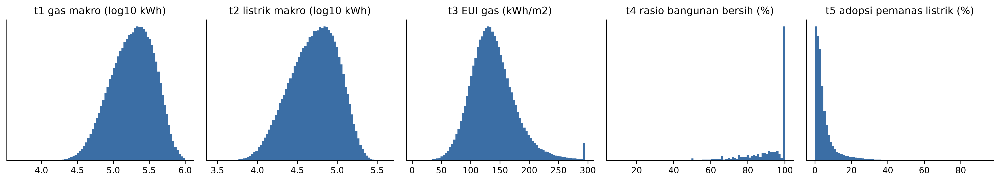
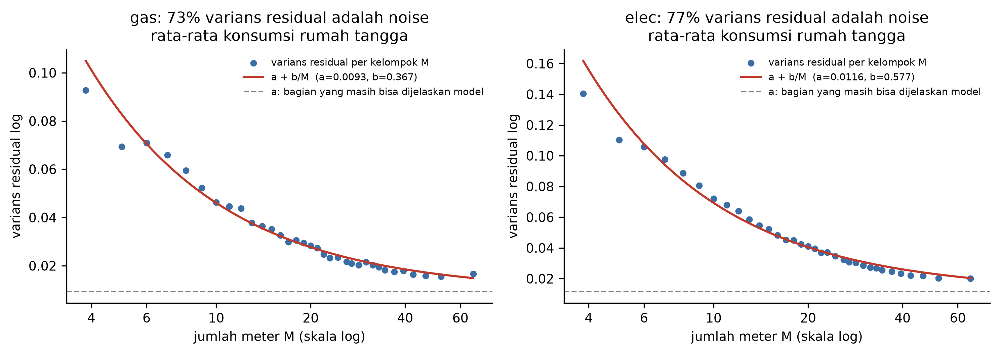
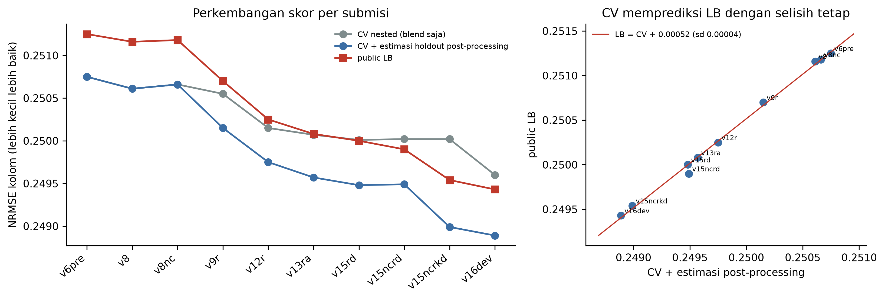
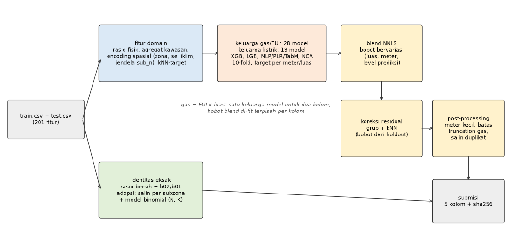
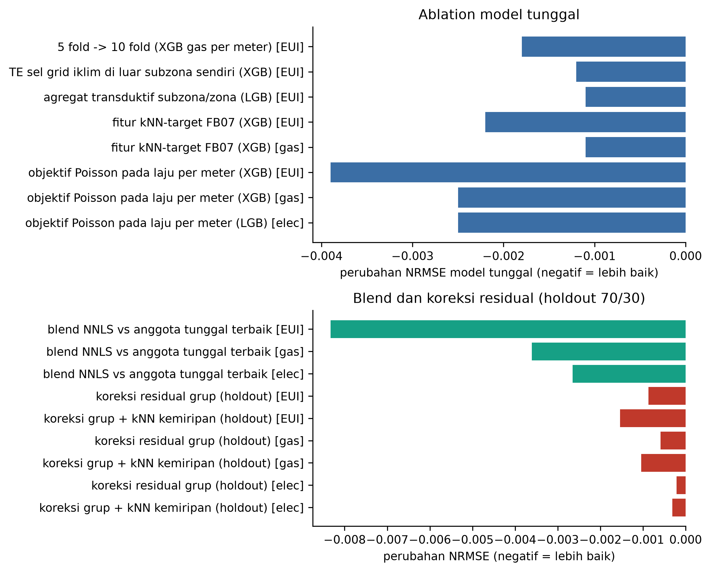
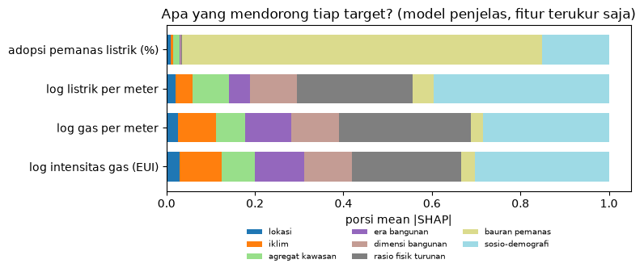
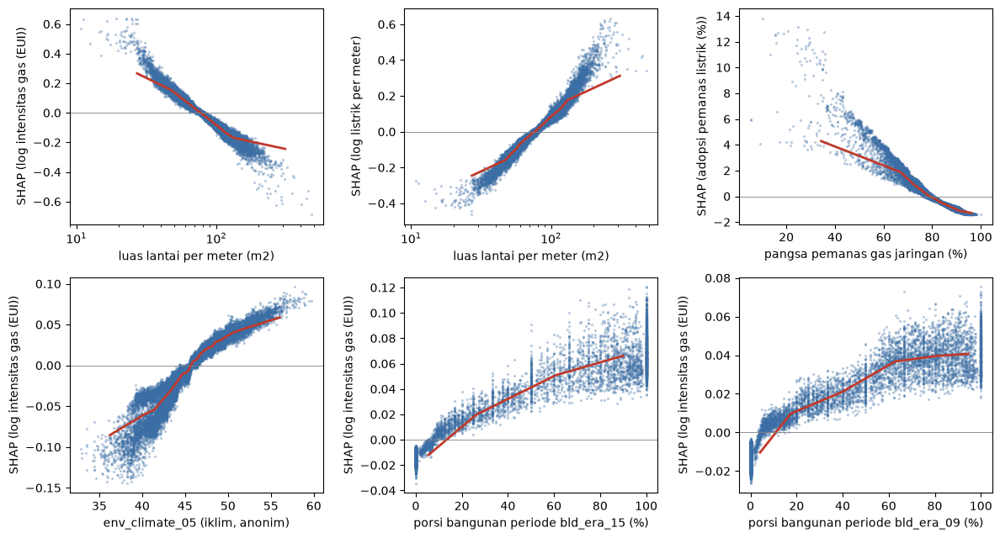
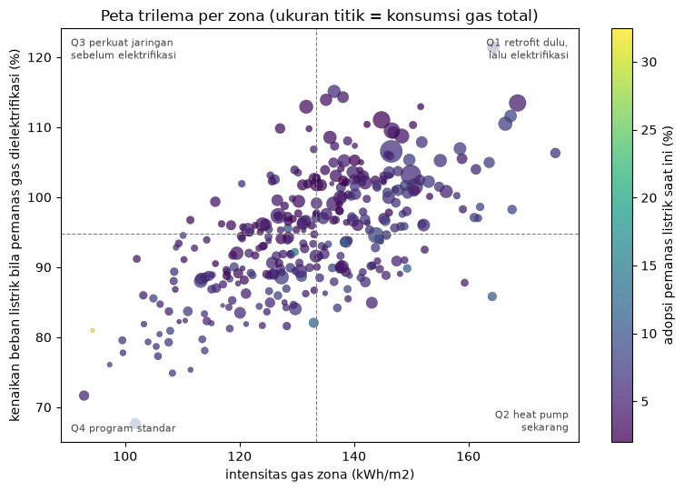

# Memprediksi Trilema Transisi Energi Perkotaan dengan Struktur Fisik Data, Ensemble yang Jujur, dan Peta Kebijakan per Zona

DICE FEST 2026, Machine Learning. Tim: BISMILLAH

## Abstrak
Kami memprediksi lima indikator energi untuk lebih dari 600 ribu kawasan permukiman: konsumsi gas, konsumsi listrik, intensitas gas per meter persegi (EUI), rasio bangunan bersih, dan adopsi pemanas listrik.

Pendekatan kami berangkat dari struktur data, bukan dari pilihan model:
- Gas dan EUI terikat identitas fisik, gas = EUI x luas lantai, sehingga keduanya dilayani satu keluarga model.
- Rasio bangunan bersih bisa dihitung eksak dari fitur. Adopsi pemanas listrik konstan di dalam subzona, sehingga untuk 92% baris test nilainya sudah diketahui, dan sisanya bisa dimodelkan sebagai proporsi binomial dari jumlah rumah tangga yang kami rekonstruksi.
- Test diambil acak per baris, sehingga informasi tingkat wilayah sah dipakai asalkan dihitung out-of-fold.

Di atas fondasi itu kami membangun fitur domain (rasio fisik, encoding spasial, rata-rata target dari kawasan dengan stok bangunan paling mirip), 41 anggota model (XGBoost, LightGBM, beberapa varian MLP, dan regresor retrieval NCA), blend non-negatif dengan bobot yang bervariasi menurut ukuran kawasan, koreksi residual spasial, dan pasca-proses yang menangani batas data. Skor public leaderboard kami 0,24913. Setiap keputusan diambil dari holdout internal yang terbukti memprediksi perubahan LB, bukan dari LB itu sendiri.

Untuk sisi kebijakan, kami melatih model penjelas per target yang hanya memakai karakteristik kawasan yang terukur, lalu menerjemahkan nilai SHAP-nya menjadi peta trilema per zona: zona mana yang perlu retrofit dulu, mana yang siap untuk heat pump, dan mana yang jaringan listriknya harus diperkuat sebelum elektrifikasi.

## 1. Pendahuluan dan pemahaman masalah
Transisi energi di kota menghadapi tiga tarikan sekaligus:
- menurunkan emisi pemanasan berbasis gas;
- menjaga jaringan listrik tetap sanggup ketika pemanas beralih ke listrik;
- memastikan manfaatnya tidak hanya dinikmati kelompok tertentu.

Kelima target memotret ketiga sisi itu: skala konsumsi (gas dan listrik total), intensitas termal (EUI), kualitas stok bangunan (rasio bangunan bersih), dan penetrasi teknologi baru (adopsi pemanas listrik).

Metrik lomba adalah rata-rata RMSE tiap target dibagi simpangan baku bekunya. Karena dihitung per kolom, setiap target boleh punya pipeline sendiri. Pada model final, EUI menyumbang sekitar 52% galat, listrik 25%, gas 20%, dan adopsi 3%. Rasio bangunan bersih bernilai nol karena dihitung eksak. Prioritas kerja kami mengikuti porsi itu.

## 2. Data dan eksplorasi
Train berisi 429.303 baris dan test 183.987 baris, dengan 201 fitur anonim dalam lima keluarga (dimensi bangunan, era konstruksi, bauran pemanas, iklim, sosio-demografi) ditambah dua ID spasial: 330 zona dan sekitar 150 ribu subzona.

Temuan yang paling menentukan arah pemodelan:
1. **Identitas eksak.**
   - EUI dikali `bld_dim_06` sama dengan gas sampai presisi mesin (selisih relatif maksimum 7e-16). Jadi `bld_dim_06` adalah luas lantai.
   - Rasio bangunan bersih sama persis dengan round(100 x `bld_dim_02`/`bld_dim_01`, 2) di 100% baris. Target ini dihitung, bukan diprediksi.
2. **Adopsi pemanas listrik konstan di dalam subzona.** Bauran pemanas `hvac_dist_*` adalah pecahan cacah per jumlah rumah tangga N. N bisa direkonstruksi eksak sebagai penyebut terkecil yang membuat semua pecahan bulat. Adopsi sama dengan sisa kategori pemanas dikurangi satu kategori yang hilang.
3. **Target makro didominasi ukuran kawasan.** Korelasi Spearman gas dengan luas lantai 0,92, dan listrik dengan jumlah meter 0,90. EUI hanya berkorelasi lemah dengan fitur tunggal (maksimum 0,18).
4. **Noise label besar dan terstruktur.** Varians residual log mengikuti pola a + b/M, dengan M jumlah meter (Gambar 2). Pola ini khas rata-rata konsumsi rumah tangga: bila konsumsi tiap rumah tangga bervariasi acak, varians relatif totalnya turun sebanding 1/M. Sekitar tiga perempat varians residual gas dan listrik adalah noise semacam ini, yang tidak bisa dijelaskan fitur apa pun.
5. **Batas data.** Gas di train terpotong tepat di bawah 1 juta kWh, dan kawasan dengan sangat sedikit meter (2 sampai 4) berperilaku berbeda dari sisanya. Keduanya kami tangani di pasca-proses (bagian 6).

## 3. Strategi validasi
Sebelum memilih skema cross-validation, kami memeriksa bagaimana data test dibuat:
- Rasio train/total tepat 0,700000.
- Proporsi test per zona tersebar persis binomial.
- Porsi baris test di subzona yang tidak muncul di train 8,14%, hampir sama dengan harapan split acak per baris (8,17%).
- Adversarial validation memberi AUC 0,50: train dan test tidak bisa dibedakan.

Kesimpulannya, test adalah sampel acak 30% per baris. CV utama memakai KFold acak per baris (10 fold, seed 42), dan statistik tingkat wilayah sah dipakai selama dihitung out-of-fold.

Pilihan skema CV menentukan kesimpulan pemodelan (Tabel 1). Dengan fold per zona, target encoding terlihat merusak, karena wilayah validasi tidak pernah terlihat saat training. Pada test yang diambil acak per baris, 92% baris punya subzona yang terlihat di train, dan target encoding justru salah satu fitur paling berharga.

**Tabel 1.** NRMSE LightGBM screening (5-fold) pada dua skema CV.

| Skema CV | Target encoding | Gas | EUI | Listrik |
|---|---|---|---|---|
| KFold per baris (meniru test) | tanpa | 0,2573 | 0,6721 | 0,3262 |
| KFold per baris (meniru test) | dengan | 0,2562 | 0,6699 | 0,3255 |
| GroupKFold per zona | tanpa | 0,2708 | 0,6923 | 0,3302 |
| GroupKFold per zona | dengan | 0,3637 | 0,8331 | 0,3474 |

**Holdout internal.** Komponen setelah blend (koreksi residual, pemilihan konfigurasi, pasca-proses) di-fit pada holdout 70/30 dari train: model dilatih di bagian 70%, baris 30% berperan sebagai test. Rantai holdout ini memprediksi perubahan LB publik dengan tepat di setiap langkah (Gambar 3), sehingga kami memakainya sebagai dasar setiap keputusan.

## 4. Rekayasa fitur domain
Fitur kami turun dari logika fisik dan spasial konsumsi energi kawasan.

**4.1 Rasio fisik.** Konsumsi kawasan adalah jumlah banyak rumah tangga, sehingga ukuran perlu dinormalkan:
- `area_per_meter`: luas lantai per meter, yaitu ukuran hunian rata-rata. Ini fitur fisik terkuat untuk semua target konsumsi.
- `area_per_epc`, `meters_per_epc`: cakupan sertifikat energi.
- `hvac_rest`: 100 dikurangi semua pangsa jenis pemanas, yaitu pangsa pemanas listrik ditambah satu kategori yang hilang.
- rasio luas dan porsi bangunan bersih.

**4.2 Target dalam bentuk intensitas.** Anggota tidak memprediksi gas total langsung, tetapi gas per meter, per luas lantai, per luas selubung, per sertifikat, atau log-nya. Bobot baris diatur agar loss setara dengan galat pada skala asli. Sebagian anggota memakai objektif Poisson (GLM laju dengan eksposur jumlah meter). Keragaman formulasi ini adalah sumber keragaman ensemble terbesar.

**4.3 Encoding spasial out-of-fold.** Rata-rata target (dalam bentuk intensitas) di subzona, zona, sel grid iklim (gabungan `env_climate_01/03/05`, sekitar 15 kawasan per sel) dan jendela ±2 serta ±10 nomor subzona yang berurutan secara spasial. Semua dihitung hanya dari baris fit tiap fold, dengan cross-fitting di dalamnya.

**4.4 kNN-target di ruang stok bangunan.** Untuk tiap kawasan, kami mengambil rata-rata target dari k kawasan dengan stok bangunan paling mirip di dalam jendela spasial. Ruang kemiripannya: log luas/meter, log sertifikat/meter, porsi era bangunan, porsi bersih, dan rasio luas; versi lanjutan menambah ruang era, ruang bangunan + sensus (PCA), dan ruang ukuran. Fitur ini memberi perbaikan model tunggal terbesar (XGBoost: EUI -0,0022, gas -0,0011, membaik di kelima fold).

**4.5 Agregat kawasan transduktif.** Jumlah baris, total luas, meter, dan sertifikat per subzona dan zona dari baris train dan test, serta porsi baris terhadap kawasannya. Tidak memakai target.

**4.6 Rekonstruksi rumah tangga untuk adopsi.** Dari N dan sisa pangsa pemanas, jumlah rumah tangga di kategori sisa K bilangan bulat, dan adopsi = 100 (K - r)/N. Untuk subzona baru, r dimodelkan dengan LightGBM berobjektif cross-entropy berbobot K, dengan fitur N, K, dan proporsi kategori di subzona tetangga.

Semua fitur bertarget lulus uji kebocoran: label baris validasi diacak, lalu fitur validasi diperiksa tetap identik.

## 5. Arsitektur model multi-output
Lima kolom target ditangani tiga jalur (Gambar 4):
- **Keluarga gas/EUI:** satu set anggota memprediksi EUI dalam berbagai formulasi. Bobot blend untuk kolom gas di-fit dengan bobot baris luas lantai (loss sama dengan galat gas), untuk kolom EUI tanpa bobot.
- **Keluarga listrik:** anggota terpisah untuk listrik per meter atau per luas.
- **Identitas:** rasio bersih dihitung langsung; adopsi disalin per subzona dan dimodelkan binomial untuk subzona baru.

**Tabel 2.** Anggota blend final per keluarga model (NRMSE OOF terbaik; bobot = porsi bobot NNLS global).

| Keluarga | Anggota gas/EUI | Anggota listrik | Terbaik EUI (gas) | Terbaik listrik | Bobot gas / EUI / listrik |
|---|---|---|---|---|---|
| XGBoost (CUDA, termasuk Poisson) | 16 | 3 | 0,6564 (0,2486) | 0,3200 | 42% / 42% / 16% |
| LightGBM (termasuk Poisson) | 5 | 4 | 0,6566 (0,2488) | 0,3197 | 13% / 20% / 23% |
| MLP | 2 | 1 | 0,6677 (0,2522) | 0,3213 | 5% / 1% / 3% |
| MLP + embedding PLR, TabM-mini | 3 | 2 | 0,6584 (0,2485) | 0,3188 | 27% / 19% / 25% |
| MLP multi-task (gas + listrik) | 1 | 2 | 0,6585 (0,2488) | 0,3186 | 6% / 11% / 26% |
| Regresor retrieval NCA | 1 | 1 | 0,6673 (0,2515) | 0,3217 | 8% / 7% / 8% |

- Semua anggota dilatih 10-fold dengan split yang sama (KFold seed 42). XGBoost memakai `hist` di CUDA, LightGBM `deterministic=True`, PyTorch dengan algoritma deterministik.
- MLP dilatih tiga seed dengan jumlah epoch tetap pada jadwal one-cycle, tanpa memilih epoch dari fold validasi, sehingga OOF tetap jujur. Varian PLR memakai embedding periodik untuk fitur numerik; TabM-mini memakai 16 adapter berbagi bobot.
- **Regresor retrieval NCA** mempelajari embedding kawasan, lalu memprediksi sebagai rata-rata target kawasan latih yang berbobot softmax dari jarak di ruang embedding. Sebagai model tunggal ia lebih lemah, tetapi galatnya paling berbeda dari anggota lain, sehingga mendapat bobot 7-8%.
- CatBoost GPU diuji dan kuat, tetapi tidak deterministik antar run, sehingga dikeluarkan.

## 6. Ensemble, koreksi residual, dan pasca-proses
**Blend dengan bobot bervariasi.** Bobot NNLS per kolom tidak dibuat konstan, tetapi berubah mulus menurut peringkat luas lantai, jumlah meter, dan level prediksi (basis hat multilinear, 8 fungsi basis). Anggota yang unggul di kawasan kecil tidak harus unggul di kawasan besar. Di holdout, ini memperbaiki skor total 0,00016, dan di LB 0,00009.

**Koreksi residual spasial.** Residual blend masih berkorelasi di antara kawasan yang berdekatan dan mirip stok bangunannya. Prediksi digeser oleh kombinasi linear rata-rata residual (di-shrink) dari zona dan sel iklim yang sama, jendela ±30 nomor subzona, dan k kawasan paling mirip di beberapa ruang kemiripan. Bobotnya di-fit di holdout internal: tetangga baris holdout hanya diambil dari bagian 70% dengan residual yang tidak pernah melihat label holdout. Konfigurasi tambahan untuk EUI dipilih dengan cek jujur split-half (pilih di separuh holdout, nilai di separuh lain).

**Pasca-proses.** Audit akhir kami (setiap klaim direproduksi ulang secara independen) menemukan dua bias sistematis yang tidak bisa diperbaiki oleh model mana pun:
- Kawasan dengan sangat sedikit meter (2-3) diprediksi sekitar 20% terlalu rendah, dan dengan 4 meter sekitar 3-7%, di ketiga target konsumsi. Semua keluarga model punya bias yang sama karena kawasan ini sangat jarang (877 baris train). Koreksi perkalian per kelompok.
- Gas terpotong di 1 juta kWh, tetapi prediksi di dekat batas itu terlalu tinggi. Kami menggeser prediksi dekat batas dengan ekspektasi normal terpotong, dan memotong semua prediksi ke batas yang tersirat dari train.
Gabungan keduanya memperbaiki skor holdout 0,000065 (semua fold negatif), dan di LB 0,00007.

**Adopsi dan duplikat.** Untuk subzona yang ada di train, nilai adopsi disalin. Untuk 8% baris di subzona baru, kategori yang hilang dimodelkan binomial. Terakhir, 77 baris test identik dengan baris train pada kunci subzona, meter, sertifikat, luas, dan satu fitur sensus yang hampir unik; semua grup duplikat di train punya target identik, sehingga targetnya disalin.

## 7. Hasil dan ablation
**Tabel 3.** Perkembangan skor public LB (rata-rata NRMSE lima target).

| Versi | Langkah utama | Public LB |
|---|---|---|
| baseline XGBoost | fitur dasar | 0,2781 (CV) |
| v12 | agregat kawasan + MLP PLR | 0,25025 |
| v15 | koreksi residual kNN | 0,24954 |
| v16 | fitur kNN-target di dalam model | 0,24943 |
| v19 | objektif Poisson + kNN-target lanjutan | 0,24934 |
| v19vc | blend bobot bervariasi | 0,24925 |
| v19nca | anggota retrieval NCA | 0,24920 |
| final | pasca-proses meter kecil + batas truncation gas | 0,24913 |

Ablation model tunggal yang paling berpengaruh:
- 10 fold dibanding 5 fold: EUI -0,0018, gas -0,0010.
- Encoding sel grid iklim di luar subzona sendiri: EUI -0,0012.
- Agregat kawasan transduktif: EUI -0,0011.
- Fitur kNN-target: EUI -0,0022, gas -0,0011.
- Objektif Poisson: EUI -0,0039, gas -0,0025, listrik -0,0025 untuk model tunggal.

Yang tidak berhasil (semua tercatat di registry eksperimen):
- Stacking level-2, blend terpisah untuk subzona baru, koreksi residual nonlinear, dan bobot koreksi yang bergantung ukuran.
- Loss Poisson pada MLP, 20 fold dibanding 10 fold.
- Koreksi residual lintas target, estimator alternatif untuk fitur kNN, variabel spasial pada bobot blend.
- Pencarian kebocoran (urutan ID, nilai gas "kembar", duplikat longgar): hanya 77 duplikat eksak yang bisa dimanfaatkan.

## 8. Interpretabilitas dan rekomendasi kebijakan
Ensemble submisi terlalu besar untuk dibaca langsung, dan sebagian fiturnya adalah encoding target yang tidak bisa dijadikan tuas kebijakan. Karena itu kami melatih satu **model penjelas** LightGBM per target yang hanya memakai karakteristik kawasan yang terukur: bangunan, era konstruksi, bauran pemanas, sosio-demografi, iklim, dan agregat kawasan, tanpa encoding target. Nilai SHAP dihitung eksak (TreeSHAP bawaan LightGBM) pada 20 ribu kawasan acak. Kesesuaian model penjelas pada fold holdout: gas per meter R² 0,75, EUI 0,56, listrik per meter 0,49, adopsi 0,99. Sisanya sebagian besar adalah noise rata-rata rumah tangga (bagian 2), jadi model ini sudah menangkap bagian yang bisa dijelaskan. Nama kolom dianonimkan panitia; makna yang kami tulis adalah dugaan dari struktur data.

**8.1 Apa yang mendorong konsumsi (Gambar 6).**

| Target | Sosio-demografi | Rasio fisik | Era bangunan | Dimensi bangunan | Iklim | Bauran pemanas |
|---|---|---|---|---|---|---|
| EUI (intensitas gas) | 30% | 25% | 11% | 11% | 9% | 3% |
| Gas per meter | 28% | 30% | 11% | 11% | 8% | 3% |
| Listrik per meter | 40% | 26% | 5% | 11% | 4% | 5% |
| Adopsi pemanas listrik | 15% | 0% | 0% | 0% | 1% | 81% |

Empat temuan yang paling relevan untuk kebijakan (Gambar 7):
1. **Ukuran hunian adalah tuas fisik terbesar, dengan arah berlawanan untuk gas dan listrik.** Dari hunian sekitar 30 m² per meter ke 300 m² per meter, kontribusi SHAP untuk log EUI turun dari +0,27 ke -0,24: hunian kecil sekitar 65% lebih boros gas per m² daripada hunian besar, karena selubungnya relatif besar terhadap volume. Untuk listrik per meter arahnya terbalik: hunian besar memakai sekitar 75% lebih banyak listrik per rumah tangga. Program efisiensi per m² dan program penurunan emisi absolut akan memilih kawasan yang berbeda.
2. **Stok bangunan lama menaikkan intensitas secara sistematis.** Kawasan yang seluruhnya berisi bangunan periode `bld_era_15` punya EUI sekitar 7% lebih tinggi daripada kawasan tanpa bangunan periode itu, dan `bld_era_09` sekitar 4%. Inilah bagian konsumsi yang bisa dipangkas dengan retrofit selubung.
3. **Iklim menggeser intensitas sekitar 15%** antara kawasan paling ringan dan paling berat (`env_climate_05`). Program dengan anggaran per rumah sebaiknya memberi bobot lebih ke kawasan beriklim berat, karena penghematan per rupiah lebih besar.
4. **Adopsi pemanas listrik ditentukan infrastruktur yang sudah ada, bukan oleh kemampuan rumah tangga.** Di kawasan dengan pangsa pemanas gas jaringan di bawah 40%, kontribusinya ke adopsi +4 sampai +12 poin persen; di atas 80%, kontribusinya negatif. Sosio-demografi hanya menyumbang 15%. Tanpa intervensi, elektrifikasi akan tetap terkonsentrasi di kawasan yang memang belum terhubung ke jaringan gas.

**8.2 Peta trilema per zona.** Kami menggabungkan target teramati (train) dan prediksi final (test) untuk semua 613 ribu kawasan, lalu meringkasnya ke 330 zona dengan dua ukuran:
- **Potensi hemat retrofit:** gas yang hilang bila bagian log EUI yang disebabkan stok bangunan (SHAP era bangunan, dimensi bangunan, dan rasio fisik) dikembalikan ke rata-rata nasional. Totalnya 7,4 TWh, atau 5,2% dari 141,4 TWh konsumsi gas.
- **Kenaikan beban listrik bila pemanas gas dielektrifikasi:** dengan asumsi 80% gas rumah tangga untuk pemanasan dan heat pump ber-SCOP 3, beban listrik zona naik rata-rata 95% (median), dari 68% sampai 121%.

**Tabel 4.** Ringkasan kuadran (garis batas = median zona).

| Kuadran | Zona | Porsi gas | Potensi hemat retrofit | Kenaikan beban rata-rata | Kebijakan |
|---|---|---|---|---|---|
| Q1: intensitas tinggi, beban rawan | 118 | 47% | 3,65 TWh | +102% | retrofit selubung dulu, lalu elektrifikasi bertahap |
| Q2: intensitas tinggi, jaringan longgar | 47 | 12% | 1,07 TWh | +90% | percepat heat pump sekarang |
| Q3: intensitas rendah, beban rawan | 47 | 15% | 0,86 TWh | +99% | perkuat gardu dan tarif fleksibel dulu |
| Q4: intensitas rendah, jaringan longgar | 118 | 27% | 1,81 TWh | +87% | program standar berbasis pasar |

**8.3 Rekomendasi.**
1. **Urutkan, jangan seragamkan.** Q1 memuat 47% konsumsi gas dan setengah potensi hemat retrofit. Di sini retrofit selubung harus mendahului heat pump: menurunkan kebutuhan panas lebih dulu memangkas tagihan dan emisi, sekaligus memperkecil lonjakan beban listrik saat elektrifikasi masuk. Zona seperti REG_273, REG_270, dan REG_045 adalah kandidat pertama (potensi hemat 6,7-8,6% dari konsumsi gas zona).
2. **Q2 adalah kemenangan cepat untuk heat pump.** Intensitas gasnya tinggi tetapi kenaikan beban listriknya di bawah median, sehingga subsidi heat pump di sini memberi penurunan emisi terbesar tanpa menunggu penguatan gardu.
3. **Libatkan operator jaringan sejak awal di Q1 dan Q3.** Zona seperti REG_290 (+121%), REG_259, dan REG_275 akan menghadapi lebih dari dua kali lipat beban listrik bila pemanasnya dielektrifikasi penuh. Penguatan gardu, tarif waktu-pemakaian, dan heat pump dengan penyimpanan panas perlu direncanakan sebelum program subsidi besar.
4. **Sasar kawasan berjaringan gas secara aktif.** Karena adopsi saat ini nyaris hanya terjadi di kawasan yang kurang terhubung ke gas, program elektrifikasi perlu insentif khusus (misalnya biaya penyambungan dan pembongkaran boiler) di kawasan dengan pangsa gas jaringan di atas 80%, yang menampung sebagian besar rumah tangga.
5. **Pisahkan target efisiensi dan target emisi.** Hunian kecil boros per m², hunian besar boros per rumah. Program efisiensi (keterjangkauan) sebaiknya menyasar kawasan hunian kecil dan stok lama, sedangkan program emisi absolut menyasar zona dengan volume gas terbesar.

**Batasan.** SHAP menjelaskan asosiasi dalam data, bukan efek kausal. Skenario beban listrik adalah perhitungan fisik sederhana di atas prediksi model, dengan asumsi yang kami tulis eksplisit. Indeks per zona dihitung dari model yang sama yang dipakai untuk submisi, sehingga konsisten dengan prediksinya dan bisa langsung dipakai sebagai daftar kerja.

## 9. Reproducibility
- Seed dikunci di semua tahap (split, model, PyTorch), tidak ada batas waktu training, urutan kolom diambil dari list yang di-sort, dan versi paket dipin di `final/requirements.txt`.
- Determinisme diuji per keluarga model: XGBoost CUDA, LightGBM CPU, MLP, dan NCA memberi hasil identik byte antar run di hardware yang sama. Pada run final, setiap array anggota yang dibandingkan identik byte dengan array pengembangan.
- Notebook utama menyematkan seluruh kode sumber dan menjalankannya dari kondisi bersih: pelatihan, perakitan submisi, evaluasi, dan analisis kebijakan. File submisi yang dipilih (sha256 aec745ab...d66e) adalah output pipeline ini.
- Notebook kedua membuat ulang submisi dari model tersimpan (dengan checksum) dalam waktu jauh lebih singkat, sebagai cadangan bila juri tidak bisa melatih ulang penuh.

## 10. Keterbatasan dan pengembangan
- Sekitar tiga perempat varians residual gas dan listrik berasal dari rata-rata rumah tangga yang tidak teramati. Perbaikan berikutnya butuh data per rumah tangga, bukan model yang lebih besar.
- Interval prediksi per kawasan bisa diturunkan langsung dari pola a + b/M, berguna bagi perencana untuk mengetahui kawasan mana yang prediksinya kurang pasti.
- Makna kolom anonim adalah dugaan; dengan nama kolom asli, rekomendasi di bagian 8 bisa dibuat lebih spesifik.
- Pipeline penuh butuh sekitar 20 jam di satu GPU 16 GB. Untuk penggunaan operasional, subset anggota berbobot terbesar memberi hampir seluruh skor dengan waktu jauh lebih singkat.

## 11. Kesimpulan
Skor kami datang dari tiga keputusan. Pertama, mencari struktur fisik sebelum memodelkan: rasio bangunan bersih selesai tanpa model, adopsi untuk 92% baris test tinggal disalin, dan gas serta EUI berbagi satu keluarga model. Kedua, membangun validasi yang meniru cara test dibuat, lalu membuktikannya di leaderboard. Ketiga, menilai setiap komponen secara jujur, dari bobot blend sampai pasca-proses, termasuk audit independen di akhir. Di sisi kebijakan, model penjelas yang hanya memakai karakteristik terukur menghasilkan peta trilema per zona yang langsung bisa dipakai sebagai urutan prioritas program retrofit, elektrifikasi pemanas, dan penguatan jaringan.
