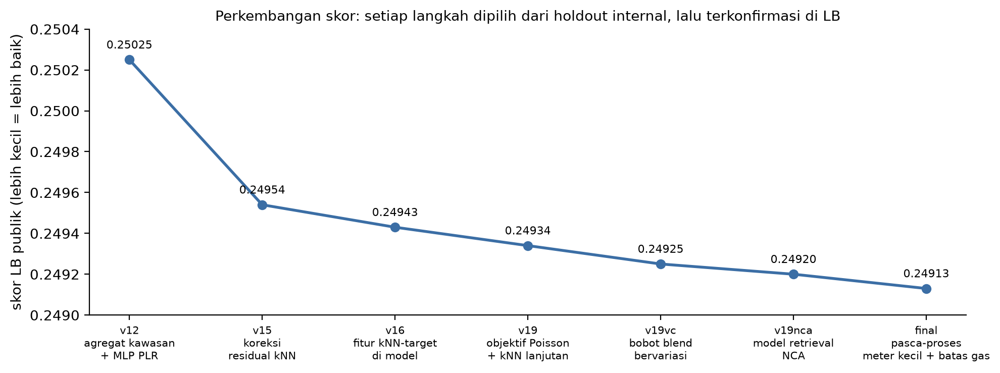

# Analisis Struktur Data sebagai Dasar Pemodelan: Prediksi Trilema Energi Perkotaan dan Prioritas Kebijakan per Zona

DICE FEST 2026, Machine Learning. Tim BISMILLAH

## Ringkasan
Penelitian ini membahas prediksi lima besaran energi pada tingkat kawasan permukiman dalam konteks transisi energi perkotaan, yaitu konsumsi gas, konsumsi listrik, intensitas gas per meter persegi (EUI), porsi bangunan bersih, dan porsi rumah tangga yang telah menggunakan pemanas listrik. Data latih terdiri atas 429 ribu kawasan, sedangkan data uji terdiri atas 184 ribu kawasan yang nilai targetnya harus diprediksi.

Tahap awal penelitian difokuskan pada *exploratory data analysis* (analisis data eksploratif) untuk memahami struktur data sebelum model apa pun dilatih. Analisis tersebut menunjukkan bahwa satu dari lima target dapat dihitung secara eksak dari kolom yang tersedia, satu target lain telah diketahui nilainya untuk 92% kawasan uji, dan dua target lainnya terhubung oleh identitas fisis sederhana. Temuan ini memungkinkan upaya pemodelan dipusatkan pada target yang tidak dapat diturunkan secara langsung.

Target yang tersisa dimodelkan melalui tiga komponen utama. Komponen pertama adalah fitur yang merepresentasikan mekanisme konsumsi energi, yaitu ukuran rumah, umur bangunan, dan kemiripan dengan kawasan sekitar. Komponen kedua adalah *ensemble* (gabungan beberapa model prediksi) yang terdiri atas 41 model dengan pola galat yang berbeda. Komponen ketiga adalah skema validasi yang meniru mekanisme pemisahan data uji sehingga perbaikan pada validasi konsisten dengan perbaikan pada *leaderboard* (papan peringkat). Pendekatan ini menghasilkan skor akhir 0,24913 pada *leaderboard* publik.

Untuk analisis kebijakan, dilatih model penjelas yang hanya menggunakan karakteristik kawasan yang terukur. Hasil interpretasi model tersebut kemudian diringkas menjadi peta prioritas untuk 330 zona. Peta ini membedakan zona yang memerlukan *retrofit* (perbaikan selubung bangunan) terlebih dahulu, zona yang siap beralih ke *heat pump* (pompa panas listrik), dan zona yang jaringan listriknya perlu diperkuat sebelum elektrifikasi.

| Hasil utama | |
|---|---|
| Skor *leaderboard* publik | 0,24913 dari *ensemble* 41 model; *notebook* (buku kerja kode) mereproduksi berkas submisi yang identik |
| Struktur data | 1 target dihitung eksak dengan rumus, 1 target sudah diketahui untuk 92% kawasan uji, gas dan EUI terhubung melalui luas lantai |
| Pendorong konsumsi | ukuran rumah (berpengaruh berlawanan arah terhadap gas dan listrik), stok bangunan lama, dan iklim; 81% kontribusi pada adopsi pemanas listrik berasal dari infrastruktur pemanas yang ada |
| Peta trilema | 118 zona (47% konsumsi gas) memerlukan *retrofit* sebelum elektrifikasi; potensi penghematan 7,4 TWh; elektrifikasi pemanas penuh menaikkan beban listrik zona rata-rata 95% |

## 1. Latar Belakang
Transisi dari pemanas berbahan bakar gas menuju pemanas listrik menempatkan pemerintah kota pada tiga tuntutan yang saling bertentangan, yang dalam penelitian ini disebut trilema energi perkotaan. Tuntutan pertama adalah penurunan emisi. Tuntutan kedua adalah keandalan jaringan listrik ketika beban pemanasan berpindah dari gas ke listrik. Tuntutan ketiga adalah keterjangkauan biaya energi bagi rumah tangga. Kelima target kompetisi mencerminkan ketiga aspek tersebut sebagaimana dirangkum pada tabel berikut.

| Target | Makna | Aspek trilema |
|---|---|---|
| gas total (kWh) | konsumsi gas tahunan kawasan | emisi |
| listrik total (kWh) | konsumsi listrik tahunan kawasan | beban jaringan |
| EUI (kWh/m²) | konsumsi gas per meter persegi lantai atau *energy use intensity* (intensitas penggunaan energi), ukuran efisiensi bangunan | emisi dan biaya |
| porsi bangunan bersih (%) | kualitas stok bangunan | emisi |
| adopsi pemanas listrik (%) | tingkat kemajuan transisi | transisi |

Unit analisis dalam penelitian ini adalah kawasan. Setiap baris data mewakili satu kawasan kecil, kurang lebih setara dengan satu wilayah kode pos, yang berisi rata-rata dua puluh rumah tangga. Data memuat 201 kolom fitur yang namanya disamarkan oleh panitia. Kolom-kolom tersebut mencakup dimensi bangunan, periode pembangunan, komposisi jenis pemanas, iklim, dan sosiodemografi. Selain itu, tersedia dua kode lokasi bertingkat, yaitu 330 zona dan sekitar 150 ribu subzona.

Kinerja model dievaluasi dengan rata-rata *root mean squared error* (akar rata-rata kuadrat galat, RMSE) yang dinormalisasi per target, yaitu Skor = (1/5) Σ RMSEk/σk untuk k = 1 hingga 5. Dalam rumus tersebut, σk adalah simpangan baku target ke-k yang bernilai tetap pada metrik kompetisi, yaitu 151.750,04 untuk gas, 41.725,37 untuk listrik, 40,65 untuk EUI, 12,49 untuk porsi bangunan bersih, dan 7,18 untuk adopsi pemanas listrik. Dengan normalisasi tersebut, prediksi konstan berupa nilai rata-rata menghasilkan skor sekitar 1,0. Karena setiap target dinilai secara terpisah, setiap target dapat ditangani dengan pendekatan yang berbeda. Pada model akhir, EUI menyumbang sekitar separuh total galat, listrik sekitar seperempat, gas sekitar seperlima, dan adopsi sisanya. Proporsi ini digunakan sebagai dasar alokasi upaya pemodelan.

## 2. Analisis Data Eksploratif
Bab ini menguraikan empat temuan struktural yang diperoleh sebelum pemodelan. Keempat temuan tersebut menentukan target mana yang perlu dimodelkan, bagaimana target dimodelkan, dan batas akurasi yang dapat dicapai.

### 2.1 Dua Identitas Fisis Tersembunyi
Hasil kali EUI dan kolom `bld_dim_06` selalu sama dengan gas total hingga presisi mesin, dengan selisih relatif terbesar 7 × 10⁻¹⁶. Hubungan ini menunjukkan bahwa `bld_dim_06` merepresentasikan luas lantai dan bahwa gas total serta EUI merupakan satu besaran yang dinyatakan dalam dua bentuk, yaitu nilai total dan nilai per satuan luas lantai. Konsekuensinya, kedua target dapat dimodelkan bersama-sama tanpa kehilangan informasi. Identitas kedua ditemukan pada porsi bangunan bersih, yang pada seluruh 429 ribu baris selalu sama dengan 100 × `bld_dim_02` / `bld_dim_01` yang dibulatkan hingga dua desimal. Dengan demikian, target ini dihitung langsung dari rumus tersebut dan tidak memerlukan model prediksi.

### 2.2 Keseragaman Adopsi dalam Subzona
Nilai adopsi pemanas listrik selalu seragam di dalam satu subzona. Temuan ini konsisten dengan sifat subzona sebagai unit sensus karena 113 dari 132 kolom sensus juga bernilai konstan per subzona. Sebanyak 92% kawasan uji berada di subzona yang juga terdapat pada data latih sehingga nilai adopsi kawasan tersebut dapat diisi langsung dari nilai subzonanya. Untuk 8% kawasan sisanya, dimanfaatkan sifat kolom komposisi jenis pemanas yang merupakan pecahan dari jumlah rumah tangga. Bilangan bulat terkecil yang membuat seluruh pecahan tersebut menjadi bilangan bulat merupakan jumlah rumah tangga di subzona, yang selanjutnya dilambangkan dengan K. Atas dasar itu, adopsi dimodelkan secara probabilistik sebagai banyaknya rumah tangga pengguna pemanas listrik dari K rumah tangga.

### 2.3 Galat yang Tidak Dapat Direduksi
Konsumsi energi satu rumah tangga dapat berbeda jauh dari tetangganya karena faktor yang tidak tercatat dalam data, seperti jumlah penghuni, kebiasaan, dan pengaturan termostat. Ketika konsumsi beberapa rumah tangga dijumlahkan pada tingkat kawasan, sebagian variasi tersebut saling meniadakan, dan variasi yang tersisa makin kecil seiring dengan bertambahnya jumlah meter di kawasan. Pola ini teramati dengan jelas pada data (Gambar 1): varians galat logaritmik mengikuti hubungan a + b/M, dengan M sebagai jumlah meter serta a dan b sebagai konstanta hasil pencocokan kurva. Berdasarkan hubungan tersebut, sekitar tiga perempat galat gas dan listrik berasal dari variasi antarrumah tangga. Implikasinya, peningkatan kapasitas model hanya memberikan perbaikan yang terbatas, sedangkan perbaikan yang lebih berarti diperoleh dengan mengurangi galat acak model itu sendiri, misalnya melalui penggabungan model dengan pola galat yang berbeda.

### 2.4 Batas Nilai pada Data
Nilai gas pada data latih tidak pernah melebihi 999.765 kWh sehingga distribusinya tampak terpotong tepat di bawah satu juta kWh. Selain itu, kawasan dengan jumlah meter sangat sedikit, yaitu 2 hingga 4 meter, menunjukkan perilaku yang berbeda dari kawasan lain. Kedua karakteristik ini ditangani secara khusus pada tahap *post-processing* (penyesuaian pascaprediksi) yang diuraikan pada Subbab 5.4.

## 3. Skema Validasi
Kinerja model pada data latih tidak menjamin kinerja yang sama pada data uji. Oleh karena itu, skema validasi perlu dirancang agar meniru mekanisme yang digunakan panitia dalam memisahkan data latih dan data uji. Untuk mengidentifikasi mekanisme tersebut, diperiksa empat indikator. Pertama, data uji berjumlah tepat 30% dari total data. Kedua, kawasan uji tersebar merata di seluruh zona. Ketiga, porsi kawasan uji yang berada di subzona yang tidak muncul pada data latih sebesar 8,14%, sesuai dengan nilai harapan pengacakan per baris sebesar 8,17%. Keempat, model klasifikasi yang dilatih untuk membedakan baris latih dari baris uji melalui *adversarial validation* (validasi adversarial) menghasilkan *area under the curve* (luas daerah di bawah kurva ROC, AUC) sebesar 0,4997, setara dengan klasifikasi acak. Keempat indikator tersebut secara konsisten menunjukkan bahwa data uji diambil secara acak per baris.

Berdasarkan temuan tersebut, skema yang dipakai adalah *10-fold cross-validation* (validasi silang sepuluh lipatan) dengan pembagian acak. Data latih dibagi secara acak menjadi sepuluh *fold* (lipatan data). Model dilatih pada sembilan *fold* dan dievaluasi pada satu *fold* yang tersisa secara bergiliran sehingga setiap baris memperoleh tepat satu prediksi validasi. Pembagian *fold* dibuat satu kali dengan *seed* (nilai awal pembangkit bilangan acak) yang tetap dan digunakan oleh semua eksperimen agar hasil antareksperimen dapat dibandingkan secara langsung.

Pemilihan skema validasi ini berpengaruh besar terhadap keputusan pemodelan. Untuk data spasial, pembagian per wilayah sering dianjurkan agar model tidak memanfaatkan kedekatan lokasi. Namun, ketika data dibagi per zona, fitur rata-rata target wilayah justru tampak menurunkan kinerja model secara drastis, misalnya galat EUI naik dari 0,6923 menjadi 0,8331 (Tabel 1). Hal ini terjadi karena baris validasi berasal dari zona yang tidak terdapat pada data latih sehingga rata-rata wilayahnya tidak tersedia, sedangkan pada data uji yang sebenarnya 92% kawasan berada di subzona yang juga terdapat pada data latih. Pada skema acak per baris, yang sesuai dengan mekanisme data uji, fitur yang sama justru menurunkan galat pada ketiga target. Dengan demikian, pemilihan skema yang keliru akan menyebabkan fitur yang sebenarnya bermanfaat tersingkir.

**Tabel 1.** Galat LightGBM (makin kecil makin baik) dengan dan tanpa fitur rata-rata target wilayah pada dua skema pembagian data.

| Skema pembagian data | Fitur rata-rata target wilayah | Gas | EUI | Listrik |
|---|---|---|---|---|
| acak per baris (sesuai data uji) | tanpa | 0,2573 | 0,6721 | 0,3262 |
| acak per baris (sesuai data uji) | dengan | 0,2562 | 0,6699 | 0,3255 |
| per zona | tanpa | 0,2708 | 0,6923 | 0,3302 |
| per zona | dengan | 0,3637 | 0,8331 | 0,3474 |

Tahap setelah penggabungan model, yaitu koreksi galat dan penyesuaian akhir, memerlukan data evaluasi yang tidak dipakai dalam penentuan bobot penggabungan. Untuk keperluan tersebut, 30% data latih disisihkan sebagai *holdout set* (bagian data latih yang disisihkan untuk evaluasi internal). Seluruh model dilatih kembali tanpa bagian ini, kemudian setiap usulan perbaikan dievaluasi padanya. *Holdout set* ini terbukti menjadi penduga yang akurat bagi data uji: pada setiap langkah, besar perbaikan skor yang diperkirakannya hampir sama dengan besar perbaikan pada *leaderboard* (Gambar 2). Oleh karena itu, tidak ada perubahan yang dipilih berdasarkan *leaderboard* publik, yang hanya dihitung dari 30% data uji dan karenanya rentan menimbulkan *overfitting* (penyesuaian berlebihan terhadap data evaluasi).

## 4. Rekayasa Fitur
Fitur adalah representasi informasi yang diberikan kepada model. Dalam penelitian ini, tahap *feature engineering* (rekayasa fitur) disusun berdasarkan satu pertanyaan pokok: faktor apa yang menyebabkan suatu kawasan mengonsumsi energi lebih banyak daripada kawasan lain? Pertanyaan tersebut dijawab melalui lima kelompok fitur yang diuraikan berikut ini.

### 4.1 Ukuran Rumah, Bukan Ukuran Kawasan
Gas total suatu kawasan terutama ditentukan oleh jumlah rumah tangga di dalamnya. Informasi tersebut lebih mencerminkan skala kawasan daripada perilaku konsumsi. Informasi yang lebih bermakna bagi model adalah konsumsi per rumah tangga. Oleh karena itu, dibentuk fitur rasio yang menormalisasi besaran kawasan, yaitu luas lantai per meter sebagai proksi ukuran rata-rata rumah, luas per sertifikat energi, meter per sertifikat, dan sisa porsi jenis pemanas. Sisa porsi jenis pemanas dihitung sebagai 100 dikurangi jumlah seluruh kategori pemanas yang tercatat, yang sebagian besar merupakan pemanas listrik. Di antara seluruh fitur, luas lantai per meter memberikan kontribusi terbesar untuk semua target konsumsi.

### 4.2 Target per Rumah Tangga, Bukan per Kawasan
Prinsip yang sama diterapkan pada target. Model tidak memprediksi gas total secara langsung, tetapi memprediksi salah satu bentuk ternormalisasinya, yaitu gas per meter, gas per meter persegi, gas per sertifikat, atau logaritma dari besaran tersebut. Prediksi kemudian dikalikan kembali dengan besaran penormalisasinya untuk memperoleh nilai pada skala kawasan. Bobot setiap baris diatur agar *loss function* (fungsi kerugian) yang dioptimalkan tetap setara dengan galat kuadrat pada skala asli, yaitu skala yang digunakan oleh metrik. Variasi transformasi target ini menghasilkan model dengan pola galat yang berbeda, dan keragaman tersebut menjadi dasar keunggulan *ensemble*. Sebagian model juga menggunakan fungsi objektif Poisson yang sesuai untuk besaran berbentuk laju per rumah tangga.

### 4.3 Informasi dari Lingkungan Sekitar
Kawasan yang berdekatan cenderung serupa karena berbagi jaringan gas dan kondisi iklim yang sama serta memiliki umur bangunan yang mirip. Untuk menangkap kemiripan spasial tersebut, dihitung rata-rata target pada beberapa tingkat agregasi, yaitu subzona, zona, petak iklim, dan kawasan dengan nomor subzona yang berdekatan. Petak iklim dibentuk dari kombinasi tiga kolom iklim yang ternyata membentuk kisi dengan sekitar lima belas kawasan per petak. Nomor subzona juga ternyata berurutan secara geografis: 99,07% pasangan subzona dengan nomor berurutan berada di zona yang sama. Fitur berbasis target seperti ini berisiko menimbulkan *target leakage* (kebocoran informasi target), yaitu kondisi ketika fitur memuat informasi dari label baris yang sedang dievaluasi. Untuk mencegahnya, seluruh rata-rata dihitung secara *out-of-fold* (hanya dari *fold* yang tidak sedang dievaluasi), dan ketiadaan kebocoran diverifikasi dengan uji otomatis.

### 4.4 Informasi dari Kawasan Termirip
Fitur dengan pengaruh terbesar dalam penelitian ini dirancang untuk menjawab pertanyaan berikut: berapa konsumsi kawasan di sekitarnya yang stok bangunannya paling mirip? Untuk setiap kawasan, dicari k kawasan terdekat dengan metode *k-nearest neighbors* (k tetangga terdekat) dalam ruang karakteristik bangunan, yaitu ukuran rumah, cakupan sertifikat, komposisi periode bangunan, dan porsi bangunan bersih, dengan pencarian dibatasi pada radius geografis tertentu. Rata-rata konsumsi kawasan-kawasan tersebut, yang juga dihitung secara *out-of-fold*, kemudian digunakan sebagai fitur. Versi lanjutannya menggunakan beberapa definisi kemiripan sekaligus, yaitu kemiripan periode bangunan saja, kemiripan bangunan dan variabel sensus, serta kemiripan ukuran saja. Fitur ini menurunkan galat EUI model tunggal sebesar 0,0022 secara konsisten pada seluruh *fold* validasi. Penurunan tersebut merupakan perbaikan terbesar yang diperoleh dari satu gagasan dalam penelitian ini.

### 4.5 Agregat Kawasan
Kelompok fitur terakhir menggambarkan konteks kawasan, yaitu jumlah kawasan, total luas lantai, jumlah meter, dan jumlah sertifikat per subzona dan per zona. Agregat ini dihitung dari gabungan data latih dan data uji tanpa menggunakan target sehingga tidak menimbulkan kebocoran informasi. Fitur ini memberikan informasi kepada model mengenai ukuran subzona tempat suatu kawasan berada.

Gambar 3 merangkum besar perbaikan yang diberikan setiap gagasan fitur dan skema pelatihan pada model tunggal, serta tambahan perbaikan yang diperoleh dari penggabungan model dan koreksi galat sebagaimana diuraikan pada Bab 5.

## 5. Pemodelan dan Penggabungan Model
### 5.1 Tiga Jalur untuk Lima Target
Berdasarkan temuan pada Bab 2, kelima target tidak diperlakukan secara seragam, tetapi ditangani melalui tiga jalur yang berbeda (Gambar 4).
- Jalur pertama menangani gas dan EUI dengan satu kelompok model karena keduanya merupakan besaran yang sama. Pada tahap penggabungan, bobot untuk kolom gas dihitung dengan penekanan pada kawasan besar yang paling menentukan galat gas pada skala asli, sedangkan bobot untuk kolom EUI dihitung tanpa penekanan tersebut.
- Jalur kedua menangani listrik dengan kelompok model tersendiri.
- Jalur ketiga menangani dua target yang strukturnya telah diketahui. Porsi bangunan bersih dihitung dengan rumus, sedangkan adopsi diisi dari nilai subzona. Untuk kawasan di subzona baru (8%), adopsi diprediksi dengan model probabilistik.

### 5.2 Empat Puluh Satu Model dengan Pola Galat Berbeda
Keunggulan *ensemble* bergantung pada keragaman anggotanya karena model yang galatnya tidak berkorelasi tinggi dapat saling mengoreksi ketika digabungkan. Oleh karena itu, digunakan beberapa jenis model yang menangkap pola data dengan cara yang berbeda.
- **XGBoost dan LightGBM**: implementasi *gradient boosting* (penguatan gradien) pada pohon keputusan yang andal untuk data tabular dan efisien untuk dilatih.
- **MLP**: *multilayer perceptron* (jaringan saraf berlapis), termasuk varian yang mentransformasi setiap fitur numerik menjadi representasi periodik (PLR), varian yang melatih enam belas subjaringan secara bersamaan (TabM-mini), dan satu jaringan yang memprediksi gas dan listrik secara bersamaan.
- **NCA**: model berbasis tetangga berupa jaringan yang mempelajari ukuran kemiripan antarkawasan, lalu memprediksi berdasarkan rata-rata kawasan yang mirip. Sebagai model tunggal, kinerjanya lebih rendah, tetapi pola galatnya paling berbeda dari model lain sehingga bermanfaat dalam *ensemble*.

**Tabel 2.** Komposisi *ensemble*. Galat terbaik adalah galat model tunggal terbaik dalam kelompoknya; bobot adalah porsi kelompok tersebut dalam *ensemble* akhir.

| Kelompok | Model gas/EUI | Model listrik | Galat terbaik EUI (gas) | Galat terbaik listrik | Bobot gas / EUI / listrik |
|---|---|---|---|---|---|
| XGBoost | 16 | 3 | 0,6564 (0,2486) | 0,3200 | 42% / 42% / 16% |
| LightGBM | 5 | 4 | 0,6566 (0,2488) | 0,3197 | 13% / 20% / 23% |
| MLP standar | 2 | 1 | 0,6677 (0,2522) | 0,3213 | 5% / 1% / 3% |
| MLP PLR dan TabM | 3 | 2 | 0,6584 (0,2485) | 0,3188 | 27% / 19% / 25% |
| MLP gas + listrik | 1 | 2 | 0,6585 (0,2488) | 0,3186 | 6% / 11% / 26% |
| NCA | 1 | 1 | 0,6673 (0,2515) | 0,3217 | 8% / 7% / 8% |

Seluruh model dilatih dengan pembagian *fold* yang sama dan *seed* yang dikunci sehingga hasilnya dapat direproduksi secara identik. CatBoost juga diuji dan memberikan hasil yang baik. Namun, implementasi CatBoost pada GPU tidak menghasilkan keluaran yang identik pada setiap eksekusi sehingga model tersebut tidak disertakan demi menjaga reprodusibilitas (kemampuan memperoleh hasil yang identik ketika proses dijalankan kembali).

### 5.3 Penggabungan dengan Bobot Adaptif
Pendekatan penggabungan yang paling sederhana adalah memberikan bobot tetap kepada setiap model. Namun, analisis galat menunjukkan bahwa model yang unggul pada kawasan kecil tidak selalu unggul pada kawasan besar. Oleh karena itu, bobot dibuat berubah secara halus sebagai fungsi dari luas kawasan, jumlah meter, dan besar prediksi itu sendiri. Bobot dibatasi agar tidak bernilai negatif sehingga hasil gabungan tetap merupakan campuran prediksi yang dapat ditafsirkan. Penyesuaian ini memperbaiki skor *leaderboard* sebesar 0,00009.

### 5.4 Koreksi Galat Wilayah dan Penyesuaian Akhir
Setelah penggabungan, galat model masih menunjukkan korelasi antarkawasan yang berdekatan dan serupa. Apabila kawasan-kawasan tetangga yang serupa sama-sama diprediksi terlalu rendah, kawasan yang bersangkutan kemungkinan besar juga diprediksi terlalu rendah. Pola ini dimanfaatkan melalui koreksi galat wilayah. Prediksi setiap kawasan dikoreksi sebesar sebagian dari rata-rata galat tetangganya pada tingkat zona, petak iklim, nomor subzona yang berdekatan, dan kawasan termirip. Besar koreksi ditentukan pada *holdout set*, dengan tetangga yang hanya diambil dari bagian data yang tidak sedang dievaluasi sehingga koreksi tidak menggunakan label baris yang dikoreksi.

Pada akhir penelitian, dilakukan audit menyeluruh. Setiap temuan audit direplikasi secara independen dengan kode tersendiri sebelum digunakan. Dua masalah terbukti nyata dan tidak dapat diatasi oleh model mana pun.
- Kawasan dengan 2 hingga 3 meter diprediksi sekitar 20% terlalu rendah, sedangkan kawasan dengan 4 meter diprediksi sekitar 3% hingga 7% terlalu rendah pada ketiga target konsumsi. Data latih hanya memuat 877 kawasan seperti ini, jumlah yang terlalu sedikit untuk dipelajari model. Masalah ini dikoreksi dengan faktor pengali per kelompok.
- Prediksi gas yang mendekati batas satu juta kWh cenderung mengalami *overestimate* (taksiran yang melebihi nilai sebenarnya), dan tujuh prediksi bahkan melampaui nilai maksimum data latih. Prediksi di sekitar batas tersebut dikoreksi dengan pendekatan *truncated normal distribution* (distribusi normal terpancung), lalu semua prediksi dipotong pada nilai maksimum data latih.

Kedua penyesuaian ini memperbaiki skor *leaderboard* sebesar 0,00007, sama dengan perkiraan *holdout set*. Selain itu, ditemukan 77 kawasan uji yang identik dengan kawasan latih pada subzona, jumlah meter, jumlah sertifikat, luas, dan satu kolom sensus yang hampir unik. Karena kelompok duplikat pada data latih selalu memiliki nilai target yang sama, target kawasan uji tersebut disalin dari pasangannya pada data latih.

## 6. Hasil
Gambar 2 menunjukkan perkembangan skor *leaderboard* publik dari 0,2503 hingga 0,24913. Perbaikan tersebut tidak berasal dari satu lompatan besar, tetapi dari akumulasi banyak perbaikan kecil yang masing-masing telah diverifikasi pada *holdout set* sebelum diajukan. Kesesuaian antara perkiraan *holdout set* dan perubahan skor *leaderboard* pada setiap langkah menunjukkan bahwa skema validasi yang digunakan mampu menduga kinerja pada data uji dengan baik.

Sejumlah pendekatan tidak memberikan perbaikan, dan seluruhnya tercatat dalam register eksperimen. Pendekatan tersebut meliputi *stacking* (penumpukan model), yaitu model lapis kedua yang dilatih dari prediksi model lain; *ensemble* khusus untuk subzona baru; koreksi galat dengan model nonlinear; *cross-validation* dua puluh *fold* sebagai pengganti sepuluh *fold*; serta penelusuran kebocoran data melalui urutan ID, nilai gas kembar, dan duplikat longgar. Banyaknya pendekatan yang tidak memperbaiki skor pada *holdout set* mengindikasikan bahwa skor akhir telah mendekati batas yang dapat dicapai dari data ini.

## 7. Implikasi Kebijakan
### 7.1 Model Penjelas
*Ensemble* 41 model terlalu kompleks untuk ditafsirkan secara langsung. Selain itu, sebagian fiturnya, seperti rata-rata target wilayah, bukan variabel yang dapat diintervensi oleh pembuat kebijakan. Oleh karena itu, dilatih satu model penjelas untuk setiap target dengan hanya menggunakan karakteristik kawasan yang terukur, yaitu bangunan, periode pembangunan, komposisi pemanas, sosiodemografi, iklim, dan agregat kawasan.

Model penjelas ditafsirkan dengan SHAP (*SHapley Additive exPlanations*), yaitu metode atribusi kontribusi fitur. SHAP menguraikan setiap prediksi menjadi nilai dasar, yaitu rata-rata prediksi pada seluruh data, ditambah kontribusi aditif dari setiap fitur. Kontribusi tersebut dihitung berdasarkan nilai Shapley dari teori permainan kooperatif sehingga jumlah seluruh kontribusi fitur selalu sama dengan selisih antara prediksi dan nilai dasar. Model penjelas memiliki kecocokan yang memadai dengan data, yaitu menjelaskan 75% variasi gas per meter, 56% variasi EUI, 49% variasi listrik per meter, dan 99% variasi adopsi. Sebagian besar variasi yang tersisa merupakan variasi antarrumah tangga yang memang tidak dapat dijelaskan oleh fitur tingkat kawasan (Subbab 2.3).

Karena nama kolom disamarkan oleh panitia, makna kolom yang dituliskan dalam bab ini merupakan dugaan berdasarkan pola data. Sebagai contoh, `hvac_dist_02` ditafsirkan sebagai porsi rumah tangga dengan pemanas gas jaringan.

### 7.2 Faktor Pendorong Konsumsi
Tabel 3 dan Gambar 5 menyajikan porsi kontribusi setiap kelompok fitur terhadap prediksi model penjelas. Sosiodemografi dan rasio fisik merupakan dua kelompok dengan kontribusi terbesar untuk ketiga target konsumsi, sedangkan kontribusi pada adopsi pemanas listrik didominasi oleh komposisi pemanas (81%).

**Tabel 3.** Porsi kontribusi (SHAP) setiap kelompok fitur.

| Target | Sosiodemografi | Rasio fisik | Periode bangunan | Dimensi bangunan | Iklim | Komposisi pemanas |
|---|---|---|---|---|---|---|
| EUI (intensitas gas) | 30% | 25% | 11% | 11% | 9% | 3% |
| Gas per meter | 28% | 30% | 11% | 11% | 8% | 3% |
| Listrik per meter | 40% | 26% | 5% | 11% | 4% | 5% |
| Adopsi pemanas listrik | 15% | 0% | 0% | 0% | 1% | 81% |

Empat pola yang paling relevan bagi kebijakan diuraikan sebagai berikut (Gambar 6).

1. Ukuran rumah berpengaruh berlawanan arah terhadap gas dan listrik. Rumah kecil (sekitar 30 m² per meter) mengonsumsi gas per meter persegi sekitar 65% lebih banyak daripada rumah besar (300 m²) karena luas dinding dan atapnya relatif besar terhadap ruang yang dipanaskan. Sebaliknya, rumah besar mengonsumsi listrik per rumah sekitar 75% lebih banyak. Artinya, program efisiensi per meter persegi dan program pengurangan emisi total akan menyasar kawasan yang berbeda.
2. Bangunan dari periode tertentu memiliki intensitas energi yang lebih tinggi. Kawasan yang seluruh bangunannya berasal dari periode `bld_era_15` memiliki EUI sekitar 7% lebih tinggi daripada kawasan tanpa bangunan dari periode tersebut, sedangkan untuk `bld_era_09` selisihnya sekitar 4%. Bagian konsumsi inilah yang dapat ditekan melalui *retrofit* pada dinding, atap, dan jendela.
3. Iklim menggeser intensitas energi sekitar 15% antara kawasan dengan iklim paling ringan dan paling berat (`env_climate_05`). Dengan anggaran per rumah yang sama, *retrofit* di kawasan beriklim berat menghasilkan penghematan yang lebih besar.
4. Adopsi pemanas listrik lebih ditentukan oleh infrastruktur daripada oleh karakteristik sosiodemografi warga. Pada kawasan dengan porsi pemanas gas jaringan di bawah 40%, kontribusi faktor ini terhadap adopsi bernilai positif, yaitu +4 hingga +12 poin persentase. Pada porsi di atas 80%, kontribusinya negatif. Faktor sosiodemografi hanya menyumbang 15%. Tanpa intervensi, elektrifikasi akan tetap terkonsentrasi di kawasan yang belum tersambung ke jaringan gas.

### 7.3 Peta Trilema per Zona
Untuk menerjemahkan temuan tersebut menjadi prioritas program, nilai aktual pada kawasan latih dan prediksi akhir pada kawasan uji untuk seluruh 613 ribu kawasan digabungkan, kemudian diringkas ke tingkat 330 zona dengan dua ukuran berikut.

- Potensi penghematan dari *retrofit*, yaitu besar konsumsi gas yang berkurang apabila komponen intensitas yang disebabkan oleh stok bangunan diturunkan ke rata-rata nasional. Komponen tersebut adalah jumlah kontribusi periode bangunan, dimensi bangunan, dan rasio fisik. Total potensi ini mencapai 7,4 TWh atau 5,2% dari 141,4 TWh konsumsi gas.
- Kenaikan beban listrik apabila pemanas gas diganti dengan *heat pump*. Perhitungan ini mengasumsikan bahwa 80% konsumsi gas rumah tangga digunakan untuk pemanasan dan bahwa *heat pump* menghasilkan 3 kWh panas dari 1 kWh listrik. Dengan asumsi tersebut, konsumsi listrik zona naik rata-rata 95%, dengan kenaikan terendah 68% dan tertinggi 121%.

Gambar 7 memetakan setiap zona berdasarkan intensitas gas dan kenaikan beban listrik. Garis median pada kedua sumbu membagi zona menjadi empat kuadran yang karakteristiknya dirangkum pada Tabel 4.

**Tabel 4.** Ringkasan empat kuadran zona.

| Kuadran | Jumlah zona | Porsi gas | Potensi penghematan *retrofit* | Rata-rata kenaikan beban | Langkah yang sesuai |
|---|---|---|---|---|---|
| Q1: intensitas tinggi, kenaikan beban tinggi | 118 | 47% | 3,65 TWh | +102% | *retrofit* lebih dahulu, kemudian elektrifikasi bertahap |
| Q2: intensitas tinggi, kenaikan beban rendah | 47 | 12% | 1,07 TWh | +90% | percepatan pemasangan *heat pump* |
| Q3: intensitas rendah, kenaikan beban tinggi | 47 | 15% | 0,86 TWh | +99% | penguatan gardu dan tarif fleksibel lebih dahulu |
| Q4: intensitas rendah, kenaikan beban rendah | 118 | 27% | 1,81 TWh | +87% | program standar |

### 7.4 Rekomendasi
Berdasarkan pemetaan tersebut, dirumuskan lima rekomendasi kebijakan berikut.

1. Program perlu diurutkan per kuadran dan tidak diseragamkan. Q1 memuat hampir separuh konsumsi gas dan separuh potensi penghematan *retrofit*. Pada kuadran ini, *retrofit* perlu didahulukan daripada pemasangan *heat pump*. Penurunan kebutuhan panas yang lebih awal mengurangi tagihan energi dan emisi sekaligus memperkecil lonjakan beban listrik ketika elektrifikasi dimulai. Zona REG_273, REG_270, dan REG_045 merupakan kandidat pertama dengan potensi penghematan 6,7% hingga 8,6% dari konsumsi gas zona.
2. Q2 menjadi prioritas jangka pendek untuk *heat pump*. Intensitas gas pada kuadran ini tinggi, tetapi jaringan listriknya masih memiliki kapasitas cadangan. Subsidi *heat pump* pada kuadran ini berpotensi memberikan penurunan emisi terbesar tanpa harus menunggu penguatan gardu.
3. Operator jaringan perlu dilibatkan sejak awal pada zona Q1 dan Q3. Zona seperti REG_290 (+121%), REG_259, dan REG_275 akan menanggung beban listrik lebih dari dua kali lipat apabila pemanasnya dielektrifikasi penuh. Penguatan gardu, *time-of-use tariff* (tarif berbasis waktu pemakaian), dan *heat pump* yang dilengkapi penyimpan panas perlu direncanakan sebelum subsidi berskala besar dibuka.
4. Insentif khusus diperlukan untuk kawasan yang sudah tersambung ke jaringan gas. Adopsi saat ini hampir hanya terjadi di kawasan yang kurang tersambung ke jaringan gas. Oleh karena itu, kawasan dengan porsi gas jaringan di atas 80%, yang menampung sebagian besar rumah tangga, memerlukan dorongan tambahan, misalnya bantuan biaya pemasangan dan pembongkaran *boiler* (ketel pemanas) lama.
5. Target efisiensi dan target emisi perlu dipisahkan. Rumah kecil memiliki intensitas gas per meter persegi yang tinggi, sedangkan rumah besar memiliki konsumsi per rumah yang tinggi. Program yang berfokus pada keterjangkauan sebaiknya menyasar kawasan dengan rumah kecil dan bangunan lama, sedangkan program pengurangan emisi menyasar zona dengan volume konsumsi gas terbesar.

Analisis ini memiliki dua keterbatasan utama. Pertama, SHAP menunjukkan asosiasi dalam data dan belum membuktikan hubungan sebab-akibat. Kedua, skenario beban listrik merupakan perhitungan fisis sederhana berdasarkan prediksi model dengan asumsi yang dinyatakan secara eksplisit. Atas dasar keterbatasan tersebut, peringkat antarzona sebaiknya lebih diutamakan daripada nilai absolutnya. Di sisi lain, indeks per zona dihitung dari prediksi yang sama dengan berkas submisi sehingga dapat langsung digunakan sebagai daftar prioritas.

## 8. Kode dan Reprodusibilitas
Reprodusibilitas dijaga melalui tiga prinsip. Pertama, *seed* dikunci pada semua pustaka dan seluruh tahap. Kedua, tidak digunakan batas waktu pelatihan sehingga jumlah iterasi tidak bergantung pada kecepatan perangkat keras. Ketiga, versi seluruh pustaka dicatat.

Seluruh solusi disajikan dalam satu *notebook* yang memuat semua modul kode serta menjalankan pelatihan, penggabungan, *post-processing*, evaluasi, dan analisis kebijakan secara berurutan. Untuk menguji reprodusibilitas, seluruh pelatihan dijalankan kembali dari awal. Setiap model menghasilkan keluaran yang identik hingga tingkat *byte* (satuan data digital sebesar delapan bit) dengan versi pengembangan, dan berkas submisi yang dihasilkan identik dengan berkas yang dipilih, dengan nilai *hash* (sidik digital berkas) SHA-256 aec745ab...d66e. Selain itu, disediakan *notebook* kedua yang mereproduksi submisi yang sama dari model yang telah disimpan, bagi pemeriksa yang tidak memiliki waktu untuk melatih seluruh model selama sekitar 20 jam. Komputasi dijalankan pada GPU NVIDIA RTX A4000 16 GB dengan Python 3.12.

## 9. Simpulan
Penelitian ini menunjukkan bahwa waktu yang dicurahkan untuk memahami struktur data jauh lebih bernilai daripada waktu yang digunakan untuk mencari model yang lebih besar. Dua identitas fisis, satu sifat data sensus, dan satu pemeriksaan mekanisme pemisahan data cukup untuk menyelesaikan dua target dan menentukan arah seluruh pekerjaan. Tahap selanjutnya bertumpu pada prosedur yang konsisten, yaitu setiap gagasan divalidasi sebelum digunakan dan setiap hasil dapat direproduksi. Dari sisi kebijakan, model yang sama dapat diterjemahkan menjadi peta prioritas yang menjawab tiga pertanyaan praktis: zona mana yang memerlukan *retrofit* lebih dahulu, zona mana yang siap beralih ke pemanas listrik, dan zona mana yang jaringan listriknya perlu diperkuat terlebih dahulu.
